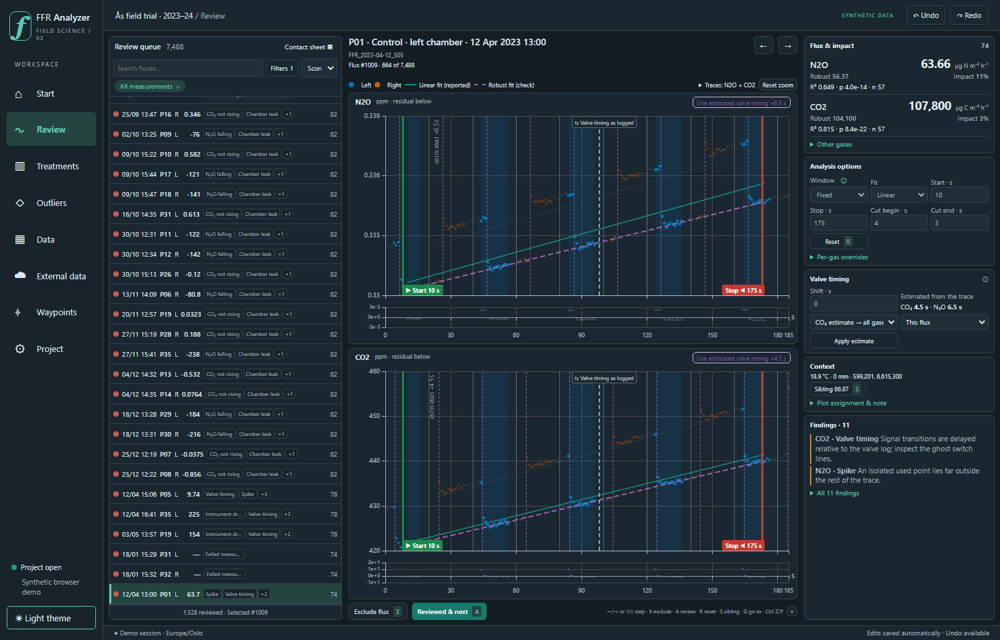
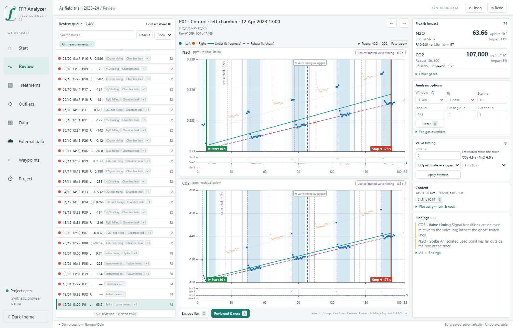
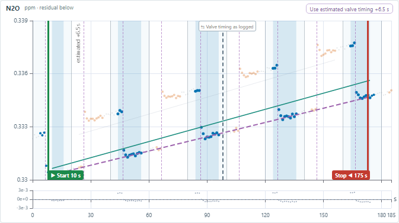
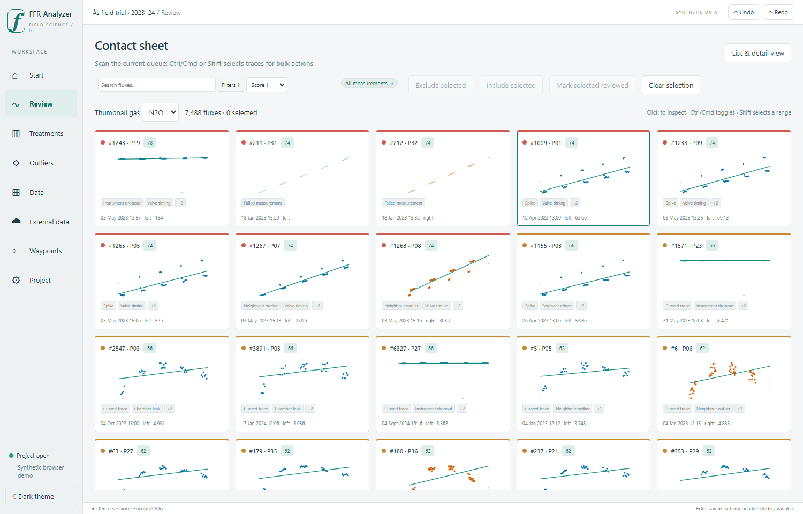
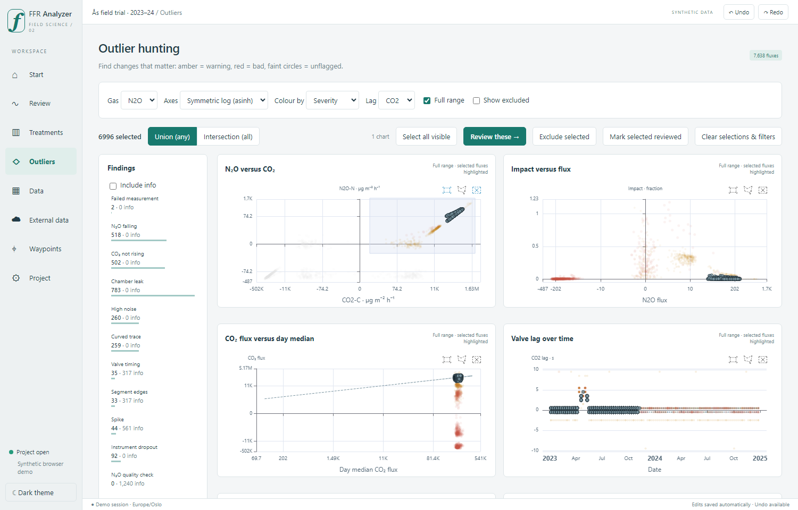
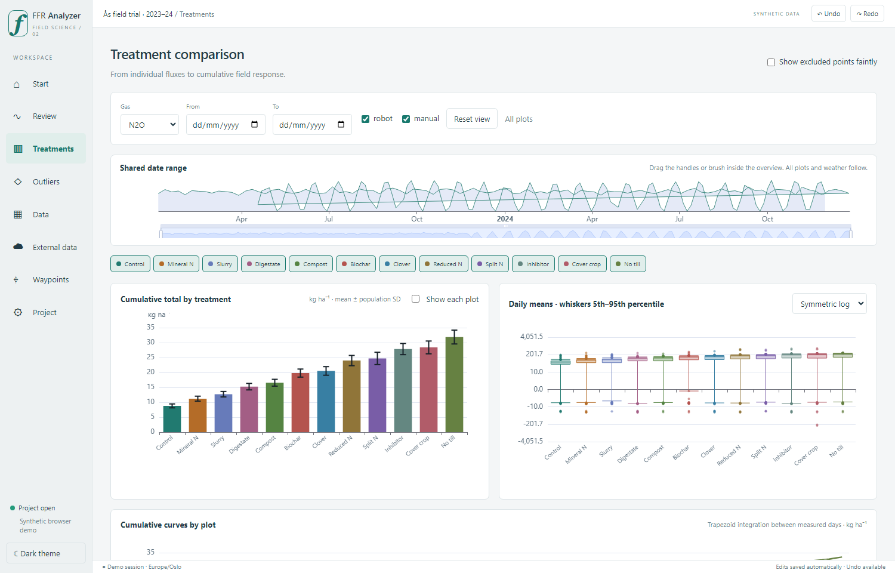
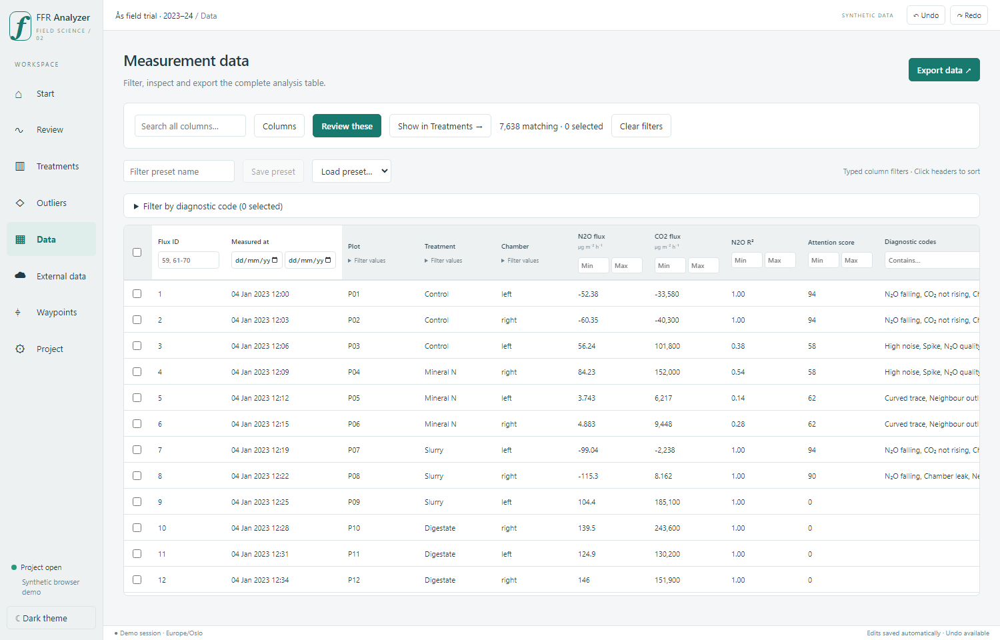
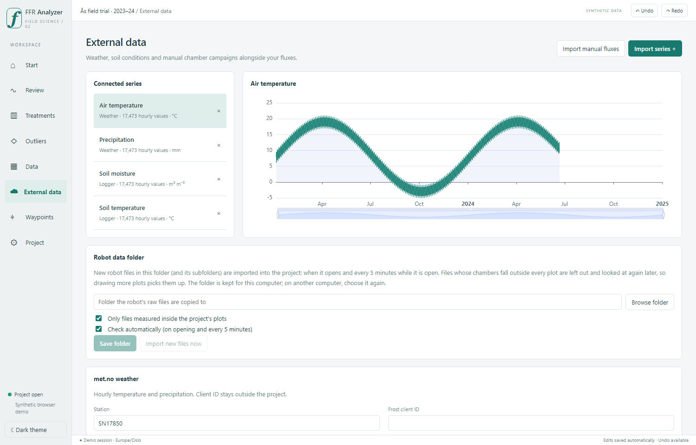
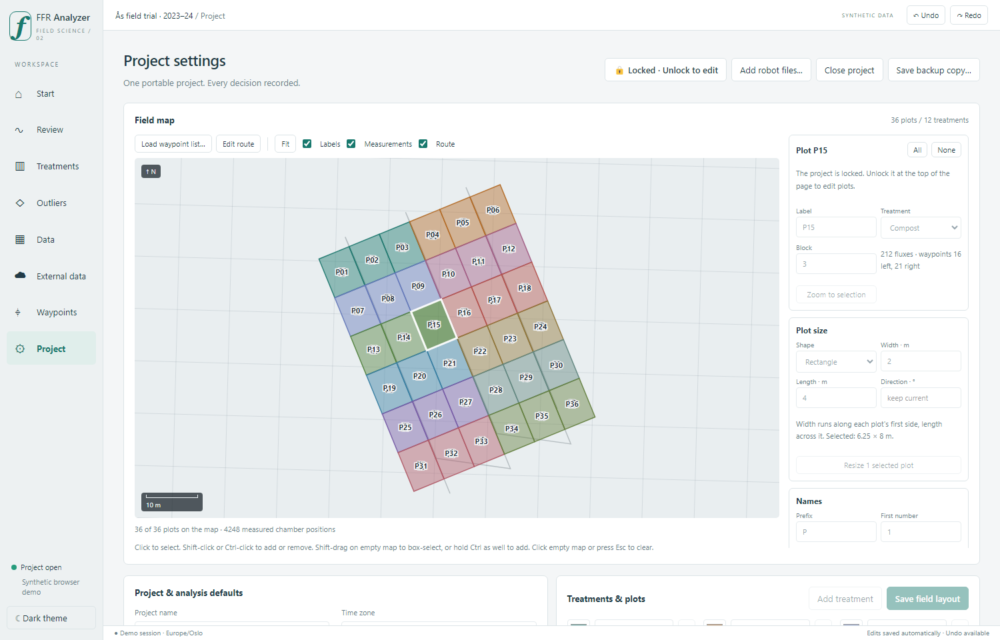
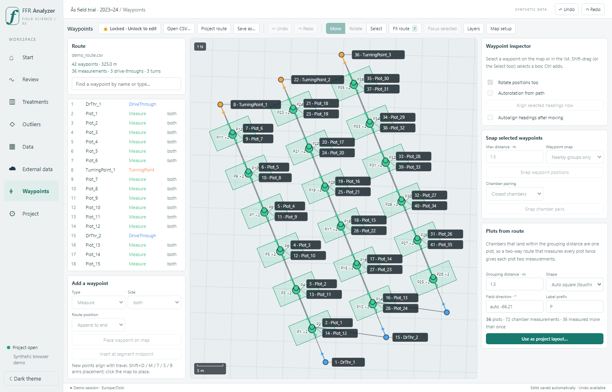

# FFR Analyzer 2

All credit for methodology and the idea of this project should go to [Lars Molstad](https://github.com/larsmolstad) as he developed the original [ffr_analysis](https://github.com/larsmolstad/ffr_analysis) program i've based this on.

Desktop program for reviewing gas fluxes measured by the Field Flux Robot: check every
chamber measurement, find the ones that look wrong, compare treatments over time, bring in
manual measurements, weather and soil loggers, and export to Excel.



**Documentation:** [User manual](docs/manual/README.md) · [Command-line tool](docs/CLI.md) ·
[Desktop app developer guide](app/README.md) · [Specification](docs/SPEC.md)

## Install

Download from [Releases](../../releases):

- `FFR.Analyzer_<version>_x64-setup.exe` installs for your Windows user only (no
  administrator rights) and opens `.ffr` files on double-click.
- `FFR-Analyzer-portable-<version>.exe` runs without installing.

Windows 10/11 is required (it uses the built-in WebView2). The program is not code-signed, so
Windows SmartScreen may say "Windows protected your PC": choose **More info → Run anyway**.

## Projects

A project is **one `.ffr` file** holding the raw robot traces, your window and exclude
decisions, treatments and plots, weather, loggers and manual fluxes. Copy the file to a
colleague and they can carry on; *Project → Save backup copy* makes a consistent copy while it
is open. Every edit is saved immediately and can be undone (Ctrl+Z / Ctrl+Y).

**Converting an old project:** *Start → Import legacy project*, pick the old `Users/<Name>`
folder. Paths from its `config.yml` (raw data, manual fluxes, loggers) are filled in; the
Capture, Truesoil and Greenmove layouts are built in. `specific_options.pickle` (your windows
and exclusions) is converted. See [Getting started](docs/manual/01-getting-started.md).

## A tour

The pictures below come from the built-in synthetic demo project; no real measurements.

### Review

Step through fluxes with ←/→. Each flux shows its trace per gas, the points used for each
chamber, valve switches, the fit and a robust refit (dashed). `X` excludes, `A` marks reviewed
and moves on, `R` resets to defaults, `S` jumps to the other chamber, `G` goes to a flux
number or date. Drag the start/stop handles to change the window. The default queue is
*Needs attention*: fluxes the program thinks look wrong, worst first.
[More in the manual](docs/manual/02-review.md).



When the analyser signal changes chamber a few seconds before or after the logged valve
switch, the chart shows the estimated timing as ghost lines and offers to apply it, for one
flux, one file or a whole day.



The **contact sheet** shows the queue as thumbnails for fast scanning and bulk actions.



### Outliers

Linked scatter plots (N2O vs CO2, impact vs flux, CO2 vs the day's median, valve lag over
time). Box-select points in any chart and every chart highlights the same fluxes; review,
exclude or mark them together. [More](docs/manual/05-outliers.md).



### Treatments

Cumulative flux per treatment and plot, daily-mean distributions, individual fluxes and
weather on one time axis. Click any point to open its trace in Review.
[More](docs/manual/04-treatments.md).



### Data and export

The full table with typed filters, saved presets and Excel/CSV export.
[More](docs/manual/06-data-and-export.md).



### External data

Import loggers or other series from Excel/CSV, fetch met.no weather (enter your Frost client
ID once; it is stored for your user, never in the project), import manual flux measurements,
and let the project pick up new files from the robot's data folder.
[More](docs/manual/07-external-data.md).



### Project and waypoints

Time zone, default analysis options, diagnostic thresholds, treatments, and a field map of
plots and measured chamber positions. Plots can be drawn from the robot's route in the
waypoint editor. [Project](docs/manual/08-project.md) ·
[Waypoints](docs/manual/09-waypoints.md).





## How "needs attention" is decided

Every flux is checked for: chamber not sealed (flat CO2 while its neighbour chamber or the
rest of the day rises), negative N2O, valve timing mismatch (the signal changes chamber a few
seconds before or after the logged valve switch), transients at segment edges, spikes, noise,
curvature, very few points, instrument dropouts, and values far from comparable fluxes. A
robust refit (estimated valve lag applied, segment edges trimmed, outlier points dropped)
shows how much each finding changes the flux; findings that do not change the result stay
informational. Nothing is ever excluded automatically. Thresholds are under
*Project → Diagnostic thresholds*. See [Why a flux needs attention](docs/manual/03-diagnostics.md).

The calculations themselves (chamber separation, regression, flux conversion, cumulative
totals) reproduce the legacy program and are described in
[How fluxes are calculated](docs/manual/10-how-fluxes-are-calculated.md).

## Development

```
crates/ffr-core   Rust domain library: parsing, chamber separation, regression, flux,
                  diagnostics, project file (SQLite), legacy import, summary, export
crates/ffr-cli    developer CLI (import, parity check, diagnostics report, export)
app/              Tauri 2 desktop shell + React/TypeScript UI (runs on a mock API in a browser)
tools/            Python helpers for checking against the legacy program
docs/             user manual, CLI reference, specification, screenshots
```

Requirements: Rust (version pinned in `rust-toolchain.toml`, installed automatically by
rustup) and Node 20.

```
cargo test                               # core tests
cd app && npm ci && npm run dev          # UI in the browser on synthetic data
cd app && npm run tauri dev              # desktop app
cd app && npm run tauri build            # installer + exe in app/src-tauri/target/release
cd app && npm run docs:screenshots       # regenerate docs/images from the synthetic demo
```

See [app/README.md](app/README.md) for the UI and [docs/CLI.md](docs/CLI.md) for `ffr-cli`.
Checks on real data are opt-in through environment variables (`FFR_CAPTURE_RAW`,
`FFR_CAPTURE_LEGACY`, `FFR_CAPTURE_MANUAL`, `FFR_CAPTURE_LOGGER`, `FFR_METNO_PICKLE`; see
`docs/SPEC.md` §9). For example `ffr-cli parity <raw folder> <capture_slopes.txt>`.

**Releases:** push a tag like `v2.0.0` and GitHub Actions builds the installer and portable
exe into a draft release (`-alpha`/`-rc` tags become pre-releases). No real measurement data
belongs in this repository.

## License

[MIT](LICENSE).
