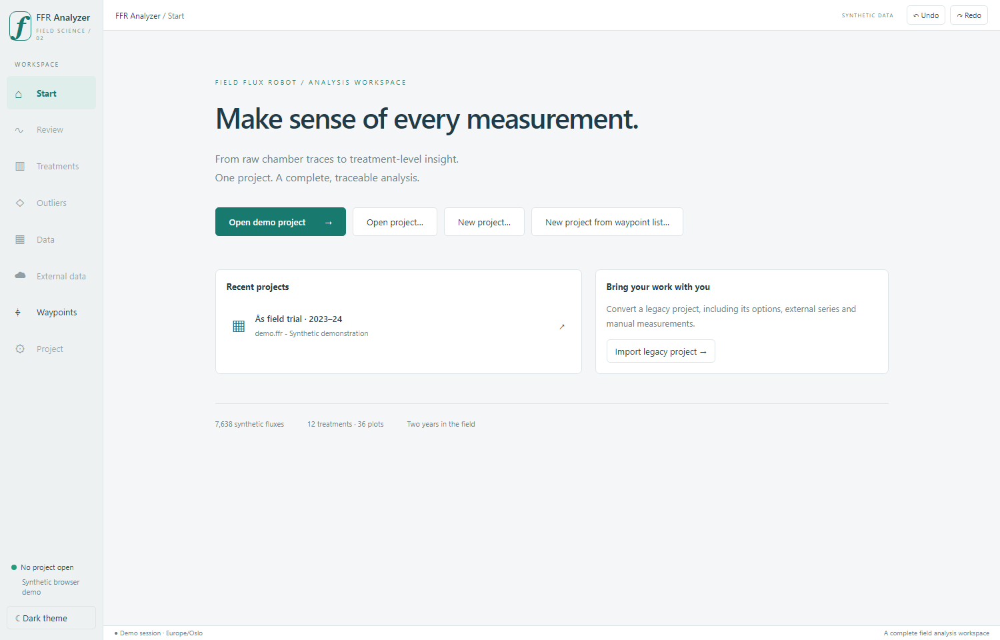
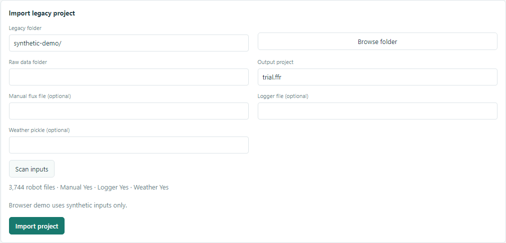

# Getting started

## Install on Windows

FFR Analyzer 2 runs on Windows 10 and 11. Choose a Windows executable from the release's **Assets**. [GitHub Releases](https://github.com/fredriknk/ffr_analysis/releases)

| Download | How to use it |
| --- | --- |
| `FFR.Analyzer_<version>_x64-setup.exe` | Run the installer. It installs for your Windows account without administrator rights. You can then double-click an `.ffr` file to open it. |
| `FFR-Analyzer-portable-v<version>.exe` | Run the file directly. To open a project, use **Open project…** in the app. |

The app is unsigned. If Windows SmartScreen shows **Windows protected your PC** for the file you downloaded from Releases, select **More info**, then **Run anyway**.

Both versions use the Microsoft Edge WebView2 Runtime, which is normally already installed. If Windows reports that WebView2 is missing, install the Evergreen Runtime and then start the app again. [Microsoft WebView2 downloads](https://developer.microsoft.com/en-gb/microsoft-edge/webview2/)

## What a project holds

A project is one `.ffr` file. It holds your imported robot traces, project settings, plots and treatments, review decisions, and any imported weather, logger or manual flux data. You can share a copy with a colleague so they can continue the analysis. They can open it without access to the folders you imported from.

The robot switches between its left and right chambers while recording gas concentrations. One robot file can give a flux for each measured chamber. In this manual, a *flux* means one chamber measurement result, with results for the gases measured.

## Open or create a project

*Start shows the project buttons, the names and paths of recent projects, and the legacy import option.*

- Under **Recent projects**, select a project to open it in **Review**. Check the path if two copies have the same name.
- To open an existing file, select **Open project…** and choose the `.ffr` file.
- To start with an empty project, select **New project…**, choose where to save the `.ffr` file, and open **Project**. The new project starts with the name **New field trial**. Set its name, time zone and field layout in [Project settings](08-project.md).
- To make plots from a robot route, select **New project from waypoint list…** and choose the waypoint CSV. In **Waypoints**, check the preview under **Plots from route**. Select **Create project from route…** and choose where to save the `.ffr` file. If the panel offers **Use as project layout…**, a project is already open. To create a separate project, go to **Project**, select **Close project**, and start again from **Start**. See [Waypoints](09-waypoints.md).

The synthetic browser demo has an **Open demo project** button. Use it to practise on example traces. The Windows desktop release opens your own projects.

## Import a legacy project

The app converts an old `Users/<Name>` project to a new `.ffr` file. It brings over saved window settings and exclusions from `specific_options.pickle` when present. Layouts for Capture, Truesoil and Greenmove are built in.

1. In **Start**, under **Bring your work with you**, select **Import legacy project**.
2. In **Legacy folder**, enter the path to the old `Users/<Name>` folder or use **Browse folder**. Choose the folder for the individual trial.
3. Select **Scan inputs**. Check the robot file count, the **Manual**, **Logger** and **Weather** indicators, and any warnings. The scan uses the legacy settings, so a moved folder can give a zero count.
4. Check **Raw data folder** and enter the current path if it is blank or out of date. Check the paths in **Manual flux file (optional)**, **Logger file (optional)** and **Weather pickle (optional)** if you have those inputs. Old paths can point to a different computer. The importer can also use manual and logger paths from `config.yml`. Enter the weather file's path if you want to import it and the field is blank, even if the scan reports **Weather Yes**.
5. In **Output project**, enter the full path and a new filename ending in `.ffr`, such as `C:\Trials\spring-trial.ffr`.
6. Select **Import project** and wait for the progress indicator to finish. The new project opens in **Review**. Check the imported dates, plot assignments and a few traces before continuing.

*After Scan inputs, check the paths and the scan result before selecting Import project.*

## Add robot data

For a single raw file, use **Project** → **Add robot files...** and choose the file. For a batch or for new files that arrive during a trial, go to **External data** → **Robot data folder**. Set the folder where you copy files from the robot. You can scan it on demand or let the app check it automatically. See [the robot data folder](07-external-data.md) for folder settings and scan results.

## Find your way around

- Use the navigation rail on the left to switch screens. **Start** and **Waypoints** are available before you open a project.
- The top bar shows the project name and current screen. Use **Undo** and **Redo** for saved project edits.
- The status bar along the bottom shows the project time zone and reports progress when the app is busy.
- Select **Dark theme** or **Light theme** at the bottom of the rail. The app remembers your choice.

## Save, undo and back up

The app saves each completed review edit to the open `.ffr` file. For example, **Exclude flux** saves when you select it, while a note saves when you leave its field. Chart adjustments save after a short pause. In **Project**, use **Save & recompute** for settings or **Save field layout** for layout changes. Edited waypoint routes save separately as CSV files. [Project settings](08-project.md) and [Waypoints](09-waypoints.md) cover those steps.

Use **Undo** or **Redo** in the top bar to step through saved project edits. In **Review**, you can also use **Ctrl+Z** and **Ctrl+Y**.

To make a consistent copy while the project is open, go to **Project**, select **Save backup copy…**, and choose a name and location. Share the backup if someone else needs a separate working copy.

## A typical workflow

1. Set the project time zone and check how plots and treatments are assigned. Start from a waypoint list if you have one. [Project settings](08-project.md) · [Waypoints](09-waypoints.md)
2. Bring in robot files and any manual fluxes, weather or logger readings. [External data](07-external-data.md)
3. Start with the fluxes needing attention. Inspect the traces, adjust the analysis where the evidence supports it, and record any exclusions. [Review](02-review.md) · [Diagnostics](03-diagnostics.md)
4. Compare fluxes across plots and treatments. Use the linked charts to investigate groups of unusual results. [Treatments](04-treatments.md) · [Outliers](05-outliers.md)
5. Filter the table and export the rows and columns you need. [Data and export](06-data-and-export.md)
