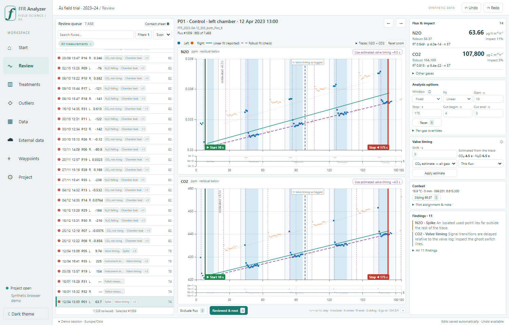
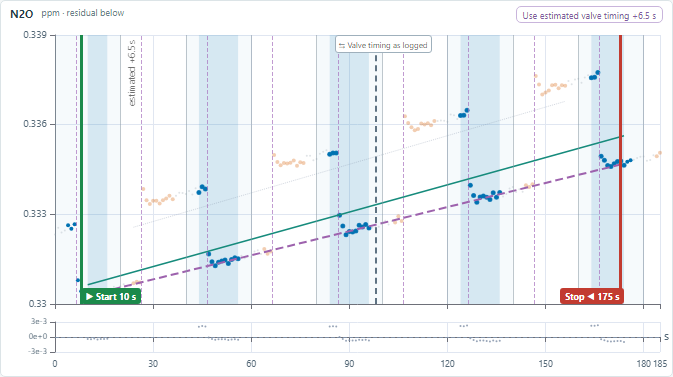
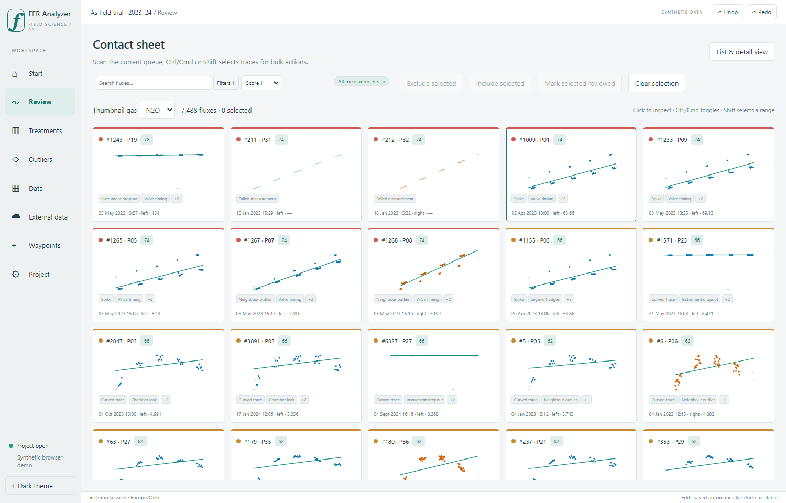

# Review fluxes

Use **Review** to check the trace for each flux. The queue is on the left, the charts are in the centre, and the results and controls are in the inspector on the right.

*The selected flux opens beside the queue, with one trace per selected gas and an inspector on the right.*

## Choose the next flux

The **Review queue** starts with unreviewed robot fluxes that need attention, highest score first. Each row shows the measurement time, plot, chamber side (**L** or **R**), N₂O flux, finding labels and attention score. Select a row to open it.

Use **Search fluxes…** to find a flux ID, filename, plot label or treatment name. Search applies within the current filters. Use the sort menu to change the order.

| Sort choice | Order |
| --- | --- |
| **Score ↓** | Highest attention score first. |
| **Time ↑** | Oldest measurement first. |
| **Plot ↑** | By plot label, then by time. |

Open **Filters** and choose a quick filter under **Queue**.

| Queue choice | Shows |
| --- | --- |
| **Needs attention, unreviewed** | Unreviewed fluxes with scores of 30 or more. This is the default. |
| **All measurements** | Every flux that matches the other filters. |
| **Unreviewed** | Fluxes you have yet to mark reviewed, at any score. |
| **Needs attention** | Fluxes with scores of 30 or more, including those already reviewed. |
| **Overridden** | Fluxes with analysis options that differ from the project defaults. |
| **Excluded** | Fluxes excluded as a whole. |

In **Filters** you can also choose **Source**, **Treatment**, **Plot**, and **From** and **To** dates. **Source** offers **Robot measurements**, **Manual measurements**, and **Robot and manual**. Date bounds use UTC and include the **To** day. The heading uses the project time zone.

Under **Diagnostic code**, select one or more findings to see fluxes with any of those findings. Selecting a code changes **Queue** to **All measurements**. Tick **Include info findings** to match informational findings as well as warnings and bad findings. The counts beside each code come from the project. Click a filter chip to remove that filter. **Reset filters** returns to the default queue and source and clears the date, plot, treatment, diagnostic and picked-flux filters. Clear the search box separately if needed.

## Navigate between fluxes

The heading shows the plot, treatment, chamber or manual source, date and time, and filename. Below it you can see the flux ID, queue position and any **EXCLUDED**, **Reviewed** or **Overridden** badges. A flux can stay open outside the current queue. When you reopen a project, **Review** can resume at the last flux you viewed. Use the arrow buttons in the heading or the arrow keys to step through the queue. Use **Sibling** or press **S** to jump to the other chamber of the same file when available.

To jump to a specific flux, press **G**, enter its ID or a date in `YYYY-MM-DD` format, and select **Go** or press **Enter**. For a date, the app opens the first flux it finds on or after midnight UTC. The app clears the current search and most queue filters after a successful jump.

When you open a flux from **Treatments**, **Outliers** or **Data**, select **Back to Treatments**, **Back to Outliers** or **Back to Data** above the heading to return to that view. **Review these** opens a queue restricted to the set passed from the other screen. Remove the **picked fluxes** chip to widen the queue.

## Read the traces

**Traces** starts with **N2O** and **CO2**. Open it to add or remove **N2O**, **CO2**, **CO**, **H2O** or **licor_H2O**. Keep at least one gas selected. Manual fluxes have no raw trace.

- Blue points belong to the left chamber and orange points to the right. The other chamber is faint, and grey points are cut or unassigned. The faint dotted fit shows the other chamber when available.
- Light bands show the selected chamber's valve segments at the current timing. Larger points and darker bands show which readings entered the reported fit.
- The solid green line shows the reported fit. With **Fit** set to **Linear**, the dashed purple fit is the robust check for N₂O or CO₂ when available. Compare the two lines to see how sensitive the flux is to timing, segment edges and unusual points.
- The residual strip below the trace shows how far each used point lies above or below the reported line. Look for a single point far from zero, a repeated pattern near switches, or a steady bend.
- The charts hide zero and analyser error readings so they do not stretch the concentration axis. The gas heading gives the hidden count when applicable. The raw file is still stored in the project.

Scroll over a chart to zoom in time or drag the plot area to pan. The traces share the time range. Select **Reset zoom** to return to the default 0–185 s view.

## Adjust the analysis window

Drag the **Start** or **Stop** handle to move the boundary. The fit previews as you drag, and the app saves after you release the handle and pause. For precise changes, type in **Start · s** or **Stop · s** under **Analysis options**. Press **Enter** or leave the field to save.

Each chart handle edits the common option unless that gas already has its own override for the same field. To adjust only one gas, first use **Per-gas overrides**. If you want to fit the window you choose, use **Fixed**. In **Auto**, the handles set the bounds of the search.

## Use the inspector

### Flux & impact

Read the reported flux and its unit, the robust estimate and **Impact** for N₂O and CO₂. **R²** describes the fit to the used points, **p** helps assess whether the slope differs from zero, and **n** is the number of points used. Open **Other gases** for the remaining results. See [How fluxes are calculated](10-how-fluxes-are-calculated.md) for the fit and units.

If a gas has an **Instrument dropout** finding, its result can show an **Exclude N2O** or **Exclude CO2** button. Use it if too little usable data remains for that gas. Treatment summaries can still use the other gases from that flux. Use **Include N2O** or **Include CO2** to reverse the decision. See [Instrument dropout](03-diagnostics.md#instrument-dropout).

### Analysis options

The options apply to the current flux. Open the information button beside **Window** for a reminder of the modes and a link to **Project analysis defaults**.

| Setting | What it does |
| --- | --- |
| **Window** → **Fixed** | Fits the usable readings from this chamber within **Start · s** and **Stop · s**, after cutting the segment edges. |
| **Window** → **Auto** | Searches within those bounds for a window of **Interval · s**. Under **Criterion**, **Steepest** favours the steepest slope and **Lowest MSE** favours the smallest fit error. Tick **CO₂ guides** to let other gases reuse the CO₂ window. |
| **Window** → **Manual slope** | Uses the value in **Slope** directly, without fitting the trace. |
| **Cut begin · s** and **Cut end · s** | Trim the beginning and end of each valve segment. Increase a cut only where the trace shows that readings near the switch still reflect the transition. |
| **Fit** → **Linear** | Reports ordinary least squares. This is the legacy fit. |
| **Fit** → **Robust** | Reports the N₂O and CO₂ robust refits where available. Other gases still use least squares. |

To change just one gas, open **Per-gas overrides**, select it, and edit **start · s**, **stop · s**, **cut Beginnings · s**, **cut Ends · s** or **valve Offset · s**. Leave the field to save the edit. Select **Use common options for N2O**, or the equivalent button for your selected gas, to remove that gas's overrides.

### Valve timing

Look for a repeated jump in concentration just before or after the solid switch lines. The dotted switch lines show the original log when a shift is applied. Dashed purple switch lines show an estimated timing where it differs from the current timing.

*Compare the dashed estimated switch lines with the concentration steps before applying a shift.*

To adjust this flux, drag the **Valve timing** handle on a trace, type a value in **Shift · s** in the inspector, or select **Use estimated valve timing** above a trace when offered. A positive shift puts switches later than the robot logged them. Dragging moves all the switches together, and the app previews which chamber each point belongs to. The chart edits the common shift unless the gas already has its own shift override.

Under **Valve timing**, **Estimated from the trace** shows separate CO₂ and N₂O estimates. Choose whether to apply an available estimate to its own gas or all gases, pick a scope, and select **Apply estimate**. If a gas shows **Unavailable**, its options are disabled.

| Scope | Applies the chosen estimate to |
| --- | --- |
| **This flux** | The selected chamber result. |
| **Both chambers of this file** | Both results from the same robot file. |
| **Every robot flux this day** | Every robot flux on that date in the project time zone, across plots and filters. |

When the chambers or gases disagree, inspect both charts before using a shared shift. Check several files across the day before applying a day-wide shift.

### Context and notes

**Context** shows the air temperature, precipitation and chamber position, plus the **Sibling** button when the other chamber has a flux. Open **Plot assignment & note** to choose a plot for this flux or enter a note. A note saves when you leave the field. Record why you changed a window or excluded a flux so someone else can follow the decision.

### Findings

**Findings** gives the number of findings and shows the two highest-severity messages first. If there are more, open **All** followed by the finding count. Use the message to locate the evidence on the chart and decide what to do. See [Diagnostics](03-diagnostics.md) for each finding and its usual checks.

## Exclude, mark reviewed or reset

- To exclude the whole result from treatment summaries, select **Exclude flux** or press **X**. The trace remains available. Use **Include flux** or press **X** again to restore it.
- When you have checked a flux, select **Reviewed & next** or press **A**. This records your review and moves through the queue. A reviewed flux can still have findings.
- To remove the current flux's analysis overrides, select **Reset** in **Analysis options** or press **R**. This restores the project analysis defaults. Use **Include flux** or the relevant gas button to reverse an exclusion.

## Scan several traces in the Contact sheet

Select **Contact sheet** in the queue to see small charts for the same filtered fluxes. Choose **N2O** or **CO2** under **Thumbnail gas**. Each thumbnail shows points for one chamber and a fit line. Use the grid to compare trace shapes. Open a trace to check the fit and its reported value in detail.

*The contact sheet shows the current queue as thumbnails, with selection and bulk actions above the grid.*

1. Click a thumbnail to open its detail view. To stay in the sheet and select fluxes, **Ctrl**-click to toggle individual thumbnails or **Shift**-click to add a range from the last thumbnail you clicked without **Shift**.
2. Check the selected count. Choose **Exclude selected**, **Include selected** or **Mark selected reviewed**. The selection can persist when you change filters, so use **Clear selection** before starting a new batch.
3. Select **List & detail view** to go back to the charts. In the sheet, **X** and **A** act on the selected group when you have one, or on the current flux otherwise. Use **Tab**, then **Enter** or **Space**, to open a focused thumbnail with the keyboard.

## Keyboard shortcuts

Click outside a text field or menu before using a queue shortcut.

| Key | Action |
| --- | --- |
| **←** or **↑** | Previous flux in the queue. |
| **→** or **↓** | Next flux in the queue. |
| **X** | Toggle whole-flux exclusion. In the contact sheet, include all targets if they are all excluded. Otherwise, exclude them all. |
| **A** | Mark the current flux or contact-sheet selection reviewed and step to the next flux. |
| **R** | Reset the current flux's analysis options to the project defaults. |
| **S** | Select the sibling chamber when available. |
| **G** | Open **Go to flux or date** in list and detail view. Press **Enter** to go. |
| **Ctrl+Z** | Undo the last project edit. |
| **Ctrl+Y** | Redo the last undone project edit. |
| **Tab**, then **←** or **→** on a chart handle | Focus a handle and adjust **Start** or **Stop** by 1 s or **Valve timing** by 0.5 s. |
| **Enter** in **Start · s**, **Stop · s**, a cut field or **Shift · s** | Commit the entered value. |
| **Tab**, then **Enter** or **Space** on a contact-sheet thumbnail | Open the focused flux in list and detail view. |

## A daily review routine

1. Import the latest robot files. In **Review**, narrow **From** and **To** to the period you are checking.
2. Start with **Needs attention, unreviewed** and **Score ↓**. For each high-priority flux, compare both gases, read **Findings**, and check the residuals and sibling as needed.
3. Change timing or the fit window when you can see a reason on the trace. If the usable data are insufficient, decide whether to exclude one gas or the whole flux.
4. Add a short note for decisions a colleague might question. Use **Reviewed & next** to move on.
5. Switch to **Unreviewed** and scan the **Contact sheet** for patterns across the remaining traces. Use [Outliers](05-outliers.md) to check unusual results against the rest of the trial.
