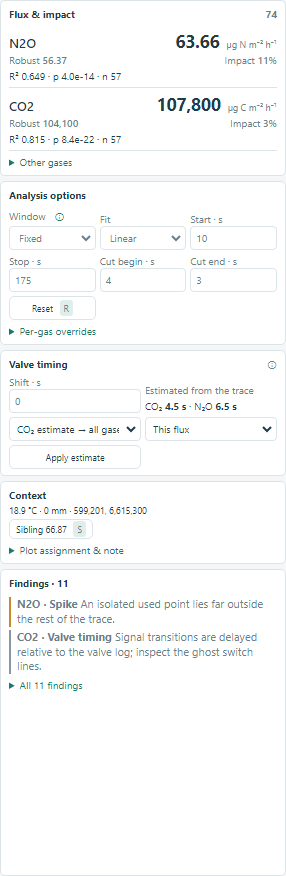

# Why does a flux need attention?

**Findings** in **Review** shows what the app detected and, where relevant, which gas it affects. Start with the message, then look for the evidence on the trace, in the residual strip or in nearby measurements. Findings help you decide what to review. The app never automatically excludes a flux or a gas. It leaves invalid readings out of a fit while keeping the flux available for review.

*The inspector puts the highest-severity findings first. Expand the findings list to read the rest.*

## Read the attention score

The attention score ranks fluxes for review. The strongest finding sets the score band. The number of findings and the size of some effects can raise the score within that band.

| Finding severity | Attention score | What it means |
| --- | --- | --- |
| **Bad** (`bad`, red) | 70–100 | Review first. A measurement may have failed, or there may be strong evidence of a problem. |
| **Warning** (`warn`, amber) | 30–69 | Check the evidence before using the result. |
| **Information** (`info`, grey) | 1–10 | Check when relevant. The effect may be small, or the finding may concern context such as a missing plot. |
| No finding that raises attention | 0 | No findings, or only the **N2O quality check**. |

**Needs attention, unreviewed** shows fluxes with scores of 30 or more that you have yet to mark reviewed. Marking a flux reviewed leaves its findings and score available. To browse informational findings, select their codes in **Filters** and tick **Include info findings**. See [Review](02-review.md#choose-the-next-flux).

## Compare the linear and robust fits

The robust refit checks how sensitive the N₂O and CO₂ results are to uncertain readings. It keeps the same window bounds, can use gas-specific estimated switch timing, trims more from valve segment edges, and refits after leaving out unusually large residuals. A residual is the difference between a reading and the fitted line.

With **Fit** set to **Linear**, the green line is the reported fit and the dashed purple line is the robust check. **Impact** compares the ordinary least-squares flux and the robust refit with either **Fit** setting. It shows their difference as a percentage of the largest of the two flux magnitudes and the gas's noise floor. The floor reflects typical uncertainty across the project and keeps tiny differences near zero in proportion. To report the robust result where available, choose **Robust** under **Fit**.

For timing, edge, spike and noise findings, the app uses the larger meaningful impact across N₂O and CO₂ to grade severity. Curvature uses the difference between the first and second halves of the fit. A shape finding stays informational if the flux change is too small relative to the noise floor. Read the finding message alongside the per-gas **Impact** values.

## Findings and what to check

The headings below use the Windows desktop labels. The synthetic browser demo uses shorter labels for some findings.

### Invalid measurement

The app could not validate the measurement or produce a fit. You may see no trace or no fitted line. Read the error, check the original robot file and valve log, and use a good copy of the file if one is available. If you cannot recover a usable result, record the reason.

*Browser demo label* **Failed measurement**.

### Valve timing mismatch

Concentration steps repeatedly occur before or after the solid valve lines. Compare the steps with the dashed purple estimates on both gas traces. If an estimate lines up with the changes, apply it to one flux and inspect the new fit before using it on more files. See [Valve timing](02-review.md#valve-timing).

*Browser demo label* **Valve timing**.

### Valve-edge transients

The first or last used points in several valve segments sit farther from the fit than the interior points. Look for repeated hooks or jumps at segment edges. Check the valve timing first. Where the signal is still settling, adjust **Cut begin · s** or **Cut end · s** and check how many points remain.

*Browser demo label* **Segment edges**.

### Residual spike

One used point lies far from the fitted line. It stands out in the residual strip. Compare the linear and robust fits and check whether the point is isolated or part of a real change. If an isolated artefact drives the result, consider **Robust** and record why you chose it.

*Browser demo label* **Spike**.

### Noisy trace

The used points scatter around the line more than is typical for this gas in the project. Look at the spread across several valve segments. Compare the sibling trace and other measurements from the same run. Check whether the slope is supported across the window before deciding whether to keep this gas.

*Browser demo label* **High noise**.

### Curved trace

The slope changes through the measurement. Look for a steady bend and a residual strip that runs above and below zero in groups. Check that the bend persists away from valve transitions. If a shorter, stable window is scientifically justified, check that it still has enough points.

### Possible chamber leak

CO₂ is low compared with a strongly emitting sibling or the day's median. The selected trace may be nearly flat while the sibling climbs. N₂O can also be low. Check chamber seating and field notes, and compare both chambers. Exclude the flux if the evidence indicates the chamber failed to seal.

*Browser demo label* **Chamber leak**.

### CO2 not rising

CO₂ falls enough to pass the negative-slope and noise checks. Look for a downward trend in the used points. A flat trace within the noise does not trigger this finding. Check the chamber assignment, timing, sibling and field notes before deciding whether the trend is credible.

*Browser demo label* **CO₂ not rising**.

### N2O decreases

N₂O falls enough to pass the negative-slope and noise checks. A stronger decline or a concurrent leak raises the severity. Check that the decline persists through several used segments and look at CO₂ for signs of a chamber problem. Keep a credible negative result and record your reasoning if needed.

*Browser demo label* **N₂O falling**.

### Neighbour outlier

The flux differs sharply from other included robot measurements of the same treatment within a few days. When there are too few, the app checks the same plot over a longer period. The trace may show a clean, unusually steep slope. Check plot assignment, recent field events and other measurements in [Outliers](05-outliers.md) before deciding whether the difference is credible.

### Short fit

The fit uses too few points or spans too little time. Look for sparse used points or a narrow fitted range. Check for gaps and check the window and cuts. Widen the window if more stable readings are available. The app shows this finding as informational on a flux with analysis overrides.

*Browser demo label* **Few points**.

### Irregular valves

Valve segments may be missing, repeated or unusually long or short. Look at the spacing of the switch lines and the alternation of the chamber colours. Check the robot log and compare the sibling. A shared time shift can move the switch lines, but it cannot supply a missing event.

*Browser demo label* **Irregular switches**.

### Instrument dropout

The N₂O or CO₂ analyser returned zero or an error code, or there is a long gap between valid readings inside a chamber segment. The chart hides invalid readings, so look for gaps and the hidden-reading count in the gas heading. Check that enough usable points remain across the fit. If one gas is unusable, use its **Exclude N2O** or **Exclude CO2** button in **Flux & impact**. The other gas can still contribute.

### N2O quality check

This is the original N₂O check. **Probably zero slope** usually means a genuine near-zero flux. Look for a flat trace with a small concentration range. For **Outliers likely**, an out-of-range message or a failed slope significance test, check the concentration range and the used points. This finding does not raise attention.

*Browser demo label* **N₂O quality check**.

### Fallback temperature

The app used the project fallback temperature to convert the slope to a flux. The trace can look normal, since the finding concerns the conversion. Check whether air temperature data cover the measurement time. If needed, bring in a series in [External data](07-external-data.md) or check **Fallback temperature · °C** in [Project](08-project.md).

### Unassigned plot

The chamber has no assigned plot. The trace can look normal. Check the chamber position in **Context** and compare it with the field map. If you know the correct plot, set it in **Plot assignment & note**. If many fluxes have this finding, check the field layout or waypoint list first.

## Diagnostic thresholds

Open **Project** and expand **Diagnostic thresholds** in **Project & analysis defaults**. To edit, select **Unlock to edit**, then use **Save & recompute**. The defaults below apply to a new Windows desktop project. Existing projects can have different values. [Project settings](08-project.md)

| Setting | Default | What it controls |
| --- | --- | --- |
| **Noise floor multiplier · ×** | 3 | Multiplies the typical flux standard error to set the gas-specific noise floor. |
| **Minimum shape effect · noise floors** | 1 | Requires the absolute change from the robust check to exceed one noise floor before it contributes to shape severity. |
| **Shape warning impact · fraction** / **Shape bad impact · fraction** | 0.15 / 0.35 | Effective impact thresholds for shape findings. These are fractions, equivalent to 15% and 35%. |
| **Extra robust trim · s** / **Robust refit residual cutoff · robust SD** | 3 s / 4 | Extra trim at both ends of a valve segment and the residual cutoff for the robust refit. |
| **Valve lag search radius · s** / **Valve lag search step · s** | 10 s / 0.5 s | How far and in what steps the app searches either side of the current timing. |
| **Minimum chamber contrast · robust SD** / **Minimum valve lag improvement · fraction** | 4 / 0.30 | How distinct the chamber signals must be for an estimate, and the minimum improvement used in the timing check. |
| **Minimum valve lag · s** | 1 s | Minimum change from the current gas shift for a valve timing finding and for the robust refit to use the estimate. |
| **Edge-to-interior residual ratio · ×** / **Spike residual cutoff · robust SD** / **High residual noise ratio · ×** | 2.5 / 6 / 4 | Cutoffs for large edge residuals, spikes and unusually high residual spread. |
| **Gases checked for curvature** | N₂O, CO₂ | Select the gas traces to check for curvature. |
| **Minimum fitted points · count** / **Minimum fit span · s** | 20 / 60 s | Minimum number of points and time span for the short-fit check. |
| **Expected valve switch count · count** / **Expected chamber segment duration · s** / **Segment duration tolerance · fraction** | 10 / 20 s / 0.5 | Expected valve switching count and duration, with a 50% tolerance on duration. |
| **Maximum gap between readings · s** | 5 s | A gap longer than this between valid readings can trigger **Instrument dropout**. |
| **Minimum leak reference · noise floors** / **Low flux leak cutoff · fraction** | 5 / 0.25 | The day or sibling CO₂ reference must exceed five noise floors. A flux below a quarter of that reference can trigger **Possible chamber leak**. |
| **Negative flux p-value cutoff · probability** | 0.01 | Significance cutoff used for falling N₂O and CO₂. |
| **Same-treatment search radius · days** / **Same-plot search radius · days** / **Minimum neighbours · count** | 3 days / 10 days / 6 | Time either side of a flux to look for treatment or plot neighbours, and minimum number required. |
