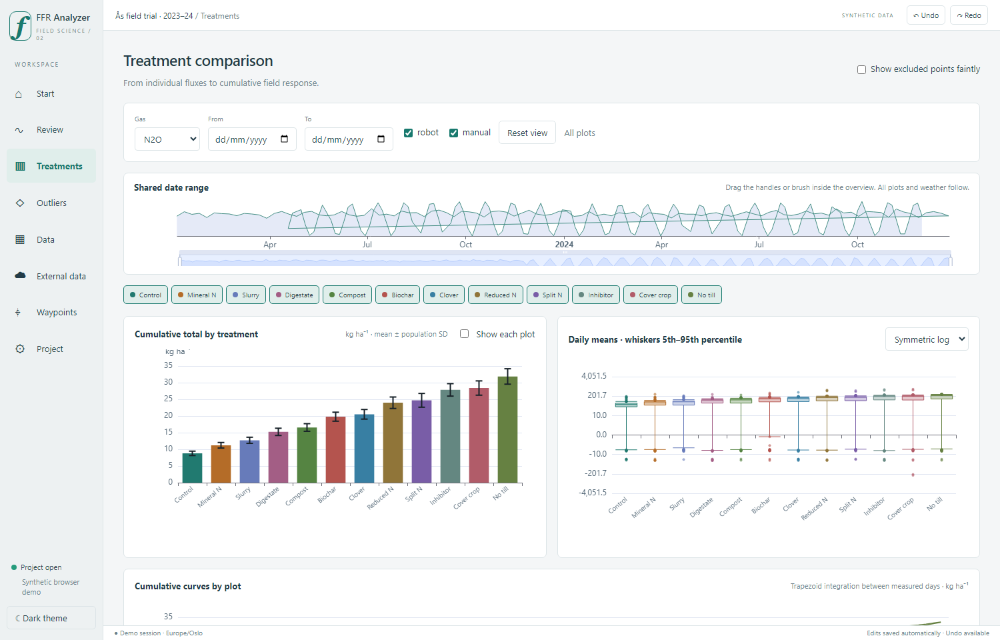
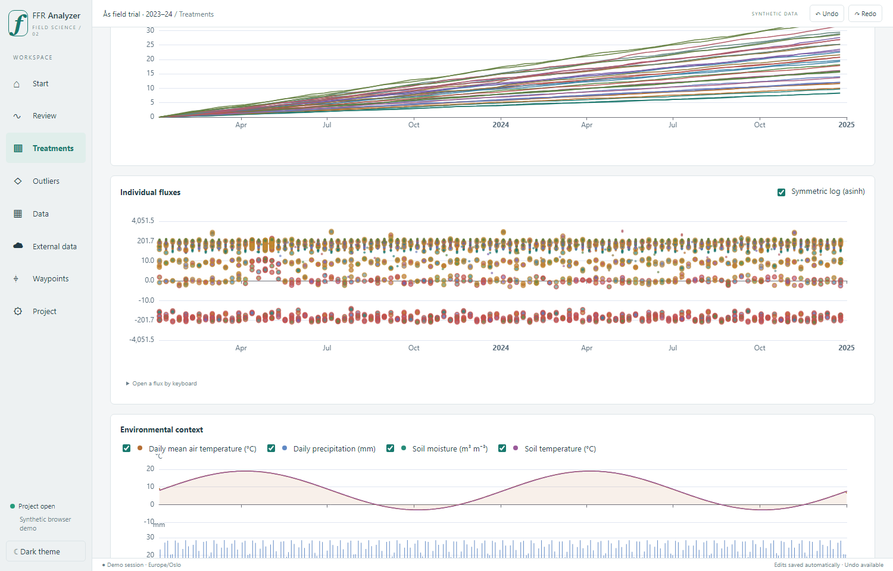

# Treatments

Open **Treatments** to compare cumulative fluxes across treatments and see how individual plots contribute to each total.

*Use the date range and treatment buttons above the cumulative totals and daily means.*

## Choose what to compare

| Control | What it does |
| --- | --- |
| **Gas** | Choose **N2O**, **CO2**, **CO**, **H2O** or **licor_H2O**. |
| **robot** and **manual** | Include either source or both. Tick both to combine the available measurements from each source. |
| **From** and **To** | Enter dates for the comparison. Leave either end blank to keep that end open. |
| **Shared date range** | Drag the handles or drag across the strip below the overview to set the dates. This updates the totals and aligns the time charts. |
| Treatment buttons | Click to hide or show a treatment. Double-click to show only that treatment in the comparison charts. |
| **Reset view** | Clear the date range, treatment focus, zoom and any row subset sent from **Data**. |

Click a bar in **Cumulative total by treatment** to focus the comparison charts on that treatment. Use **Reset view** to restore the full comparison, or click a treatment button to leave the focus and toggle that treatment.

## Read the charts

| Panel | How to read it |
| --- | --- |
| **Cumulative total by treatment** | Each bar is the mean of the plot totals for that treatment. The whiskers show one population standard deviation (SD) on either side of the mean. Tick **Show each plot** to see each plot's total as a separate bar. |
| **Daily means · whiskers 5th–95th percentile** | Each box summarises the daily means of the plots in that treatment. The middle line is the median. The box spans the middle half of the values. Whiskers run from the 5th to the 95th percentile. Dots show daily means beyond the whiskers. Choose **Symmetric log**, **Linear** or **Log (positive)** for the scale. |
| **Cumulative curves by plot** | Each line tracks the running total for one plot. Compare when totals rise or fall and how far apart the plots end up. |
| **Individual fluxes** | Each dot is one flux. **Symmetric log (asinh)** compresses large values while keeping zero and negative values visible. Amber and red outlines indicate fluxes flagged for attention. **Show excluded points faintly** adds grey dots for excluded measurements with a flux value. |
| **Environmental context** | Compare fluxes with imported weather and logger series on the same time axis. The daily mean air temperature is a line in °C. Daily precipitation is shown as bars in mm. Tick or untick series to show or hide them. |

Click a dot in **Individual fluxes** to open that measurement in **Review**. A dot beyond the box plot whiskers opens the flux linked to that daily mean. To open a flux by ID, expand **Open a flux by keyboard**, enter its ID and press Enter. Use **← Back to Treatments** to return to your comparison. See [Review](02-review.md).

*Compare flux peaks with weather on the same dates and click an individual flux to inspect it.*

In **Cumulative emissions map**, set **Colour by** to **Treatment** or **Cumulative emission**. Select a plot on the map or from **Map plot** to see its total. Use **Review [number] fluxes** to open that plot's contributing measurements as a queue.

## How the totals are calculated

1. The app averages the selected gas's fluxes for each plot on each measured day, using the project time zone. Whole-flux exclusions and exclusions for the selected gas never count in the comparison statistics.
2. For N₂O and CO₂, it converts the daily means from µg m⁻² h⁻¹ to kg ha⁻¹ h⁻¹. Between consecutive measured days it averages the two daily rates and multiplies by the hours between the dates. This is the trapezoid method. It bridges days with missing measurements. The running total starts at zero on the first measured day and ends at the last. A plot with one measured day has a total of zero.
3. Within each treatment, the app gives each plot total equal weight. The bar shows their mean and the whiskers show their population SD, a measure of the spread across those plots.

The app also calculates a geometric mean and geometric SD for the positive individual fluxes in each treatment. These describe a typical positive flux and its spread as a multiplier. The cumulative bars use the arithmetic mean and population SD of the plot totals.

Use N₂O or CO₂ for cumulative mass totals. The app also labels cumulative results for **CO**, **H2O** and **licor_H2O** as kg ha⁻¹, even though their input rates are in mol m⁻² s⁻¹ and the calculation uses the same multiplier as for N₂O and CO₂. See [How fluxes are calculated](10-how-fluxes-are-calculated.md).
