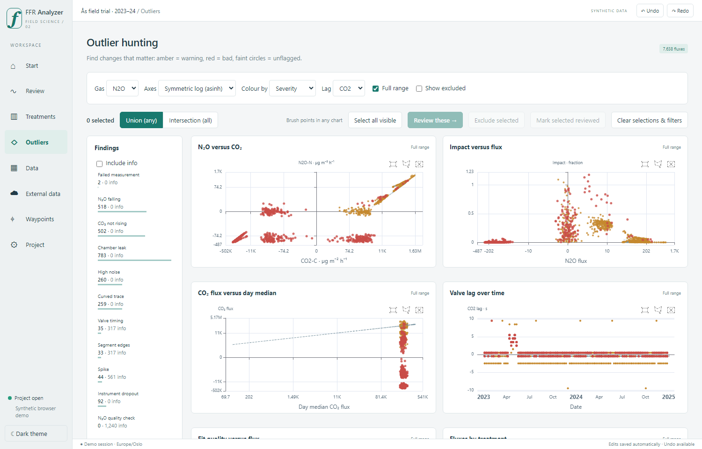
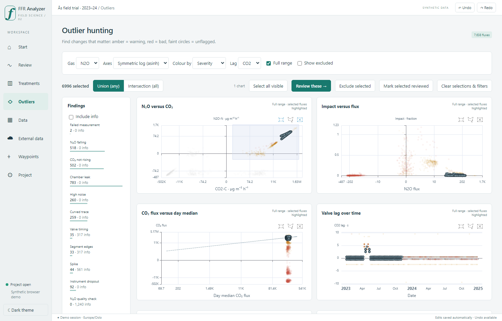

# Outliers

Open **Outliers** to spot unusual fluxes and see whether the same measurements stand out across several charts. Click a point to inspect it in **Review**.

*The linked charts compare the same measurements from several angles.*

## Choose a chart

| Chart or panel | What to look for |
| --- | --- |
| **N₂O versus CO₂** | Compare the two gases from each measurement. Look for isolated points, such as unusual N₂O values paired with very low CO₂. |
| **Impact versus flux** | Find fluxes that change substantially when the app uses a robust fit. Impact is shown as a fraction. |
| **CO₂ flux versus day median** | Find measurements well below the day's typical CO₂ flux. This can help flag chambers that did not seal. |
| **Valve lag over time** | Look for a run of measurements with a similar timing shift. The estimated lag is in seconds. |
| **Fit quality versus flux** | Look for large fluxes with low R². Open the trace to see how well the fitted line follows the points. |
| **Fluxes by treatment** | Compare fluxes over time. Choose **Colour by** and **Treatment** to see whether an extreme value is isolated or appears across a treatment. |
| **Findings** | See counts by diagnostic. Click a finding to filter every chart to it, and click it again to remove the filter. Tick **Include info** to include informational findings in the filter. |

## Adjust the view

| Control | Options |
| --- | --- |
| **Gas** | **N2O** or **CO2** for the impact, fit quality and fluxes by treatment charts. |
| **Axes** | **Symmetric log (asinh)** keeps zero and negative fluxes visible while compressing extremes. **Linear** uses equal intervals. **Log (positive only)** leaves non-positive values off axes that use the log scale. |
| **Colour by** | **Severity** uses amber for warnings, red for bad findings and faint circles for lower-attention fluxes. **Treatment** uses treatment colours. |
| **Lag** | **CO2** or **N2O** for **Valve lag over time**. |
| **Full range** | On by default. Untick it to use the 1st to 99th percentiles for the numeric axes. More extreme points move to the edges. Hover to see their actual values. |
| **Show excluded** | Include measurements already marked as excluded. |

A flux can appear only in charts for which it has both values. For example, a manual flux can be absent from the fit quality chart.

## Select and review fluxes

1. Use the rectangle icon above a chart and drag a box around the points. For an irregular group, use the polygon icon to draw a lasso. The selection can extend beyond the plot area. You can make several selections within a chart.
2. To combine selections across charts, choose **Union (any)** for fluxes picked in at least one chart. Choose **Intersection (all)** for fluxes picked in every chart with a selection. With a non-empty result, every chart highlights the matching points it can show and dims the others.
3. Check the selected count and choose **Review these →** to open the set as a queue. For a batch decision, use **Exclude selected** or **Mark selected reviewed**. Exclusion keeps those fluxes out of treatment calculations. Marking them reviewed records your review.

Use **Select all visible** to select all fluxes in the current filtered set. Use a chart's clear icon to clear its selection. **Clear selections & filters** clears every selection and the finding filter, unticks **Include info** and hides excluded fluxes again.

*A box selection in N₂O versus CO₂ highlights the same fluxes in the other charts wherever they have values.*

## Try a targeted search

- **Suspected chamber leak.** Click **Chamber leak** in **Findings**. In **CO₂ flux versus day median**, select points well below the day's median. Open **Review these →** and compare the trace with the other chamber from the same file before deciding whether to exclude.
- **Suspected valve timing shift.** Click **Valve timing**. In **Valve lag over time**, select a run of similar non-zero lags. Open the queue and compare the concentration changes with the valve switches in **Review**. See [Diagnostics](03-diagnostics.md) for what to check before applying an offset.
