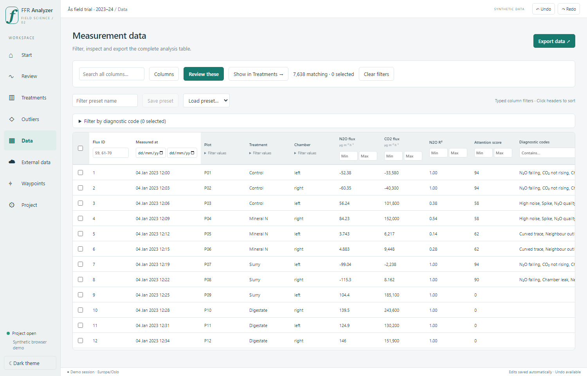

# Data and export

Open **Data** to find fluxes, inspect their measurements and export the rows and columns you need. There is one row per chamber flux, including imported manual fluxes.

*The table shows matching measurements. Use the boxes below the headers to filter them.*

## Choose columns and filter rows

Click **Columns** to open **Visible columns**. Use **Find a column…** and tick the fields you need. **Flux ID** and **Measured at** stay on the left as you scroll across the table.

Use **Search all columns…** for a broad search. To narrow it further, use the filters in the column headers.

| Column kind | How to filter |
| --- | --- |
| **Flux ID** | Enter IDs or ranges separated by commas, such as `59, 61-70`. |
| Number | Enter **Min**, **Max** or both. |
| Date | Set the first date, last date or both. The end includes the whole selected date in UTC. |
| Category | Open **Filter values** and select one or more entries. Hold Ctrl to pick several entries. |
| Flag | Open **Filter values** and choose **Yes** or **No**. |
| Text | Enter part of the text in **Contains…**. Upper and lower case match equally. |

Open **Filter by diagnostic code** to show rows with any of the chosen findings. Click a column header to sort and click again to change direction. The arrow shows the current sort direction.

To reuse column filters, enter a **Filter preset name** and click **Save preset**. Choose the name in **Load preset…** to apply those column filters again on this computer. **Clear filters** clears the search, column filters, diagnostic filter and row selection.

## Open matching or selected fluxes

Click a cell to open that flux in **Review**. Tick row boxes to pick a set. The header checkbox selects all matching rows.

Use **Review these** to open a queue of the ticked rows, or all matching rows if you have ticked none. **Show in Treatments →** sends the same set to **Treatments**. Use **Reset view** there to remove the subset. Row selections can carry over when you change filters. Check the selected count before opening or exporting a set.

## Export to Excel or CSV

To export one plot, open **Filter values** under **Plot** and choose the plot. Use **Columns** to show the fields you need, then click **Export data ↗**. Check the row and column counts in **Export measurements**. The export uses selected rows if you have ticked any and all matching rows otherwise. Include **Excluded** and the gas-specific exclusion flags if you need to track them in your analysis.

| Format | **Workbook layout** | What the file contains |
| --- | --- | --- |
| **Export Excel** | **Flat table** | One sheet named `All Data`, with one row per exported flux. |
| **Export Excel** | **Sheet per plot** | One sheet named `Plot <ID>` per plot, using the numeric plot ID, with one row per exported flux. Unassigned rows go to a sheet named `Plot ` with a blank ID. |
| **Export Excel** | **Daily means per plot** | The same sheet grouping, with one row per measured day in the project time zone. Numeric values are averaged and other fields are copied from the first row of the day. The extra columns are listed below. |
| **Flat CSV** | Any | One comma-separated file with one row per exported flux. |

Headers use the export keys listed below. Missing values are blank. Flat exports and individual rows in plot sheets are written in flux ID order. The `time` column in a flat or individual-flux export is a UTC timestamp in milliseconds since 1 January 1970. In **Daily means per plot**, it represents midnight of the grouped date, encoded as a UTC timestamp.

The daily workbook uses the rows you send it, including any excluded rows in that set. To calculate a daily export for one gas without excluded observations, filter **Excluded** and that gas's exclusion flag to **No** before choosing the rows. **Treatments** applies exclusions separately for each gas.

| Extra daily column | Unit | Contents |
| --- | --- | --- |
| `timediffHours` | h | Hours since the previous measured day in the sheet. The first row is zero. |
| `N2O_cumulative` | kg N ha⁻¹ | Running total from the daily N₂O means. |
| `CO2_cumulative` | kg C ha⁻¹ | Running total from the daily CO₂ means. |

Both cumulative columns start at zero. An interval adds to the total for a gas when both consecutive daily rows have a mean for that gas.

## Common columns

| Column in **Data** | Export key | Unit or meaning |
| --- | --- | --- |
| **Flux ID**, **Measured at** | `id`, `time` | Flux ID and measurement time. The table displays the time in the project time zone. |
| **Plot**, **Plot ID**, **Treatment**, **Chamber**, **Source** | `plotLabel`, `plotId`, `treatmentName`, `side`, `source` | Field assignment, chamber side and robot or manual source. |
| **N2O flux**, **CO2 flux** | `N2O_flux`, `CO2_flux` | Reported gas flux, in µg N m⁻² h⁻¹ for N₂O and µg C m⁻² h⁻¹ for CO₂. |
| **CO flux**, **H2O flux**, **licor_H2O flux** | `CO_flux`, `H2O_flux`, `licor_H2O_flux` | Reported gas flux in mol m⁻² s⁻¹. |
| **N2O robust flux**, **CO2 robust flux** | `<gas>_robustFlux` | Robust refit flux, in the same units as the reported flux for that gas. |
| **N2O robust fit impact**, **CO2 robust fit impact** | `<gas>_impact` | Unitless fraction describing the size of the change with the robust fit. |
| **N2O r²**, **CO2 r²** | `<gas>_rsq` | Unitless fit quality statistic. |
| **Estimated CO2 lag**, **Estimated N2O lag** | `valveLagS`, `N2O_lagS` | Estimated valve timing shift in seconds. |
| **Review attention** | `attention` | Review priority score from 0 to 100. |
| **Diagnostic codes** | `diag` | Comma-separated findings. The table shows finding names and the export contains codes. |
| **Excluded**, **Reviewed** | `excluded`, `reviewed` | Whole-flux flags. |
| **N2O excluded (this gas)** and other gas exclusion fields | `<gas>_excluded` | Flag for the named gas. |
| **Air temperature (flux interpolation)**, **Precipitation (flux interpolation)** | `airTemp`, `precip` | Interpolated weather, in °C and mm/h. |
| Joined weather and logger series | Series key, such as `air_temperature` or `TEMPC_GROUND` | Nearest value within the series' allowed time gap. Units depend on the series, such as °C for temperature or m³/m³ for soil water content. |

See [External data](07-external-data.md) for how the series are matched to flux rows.
