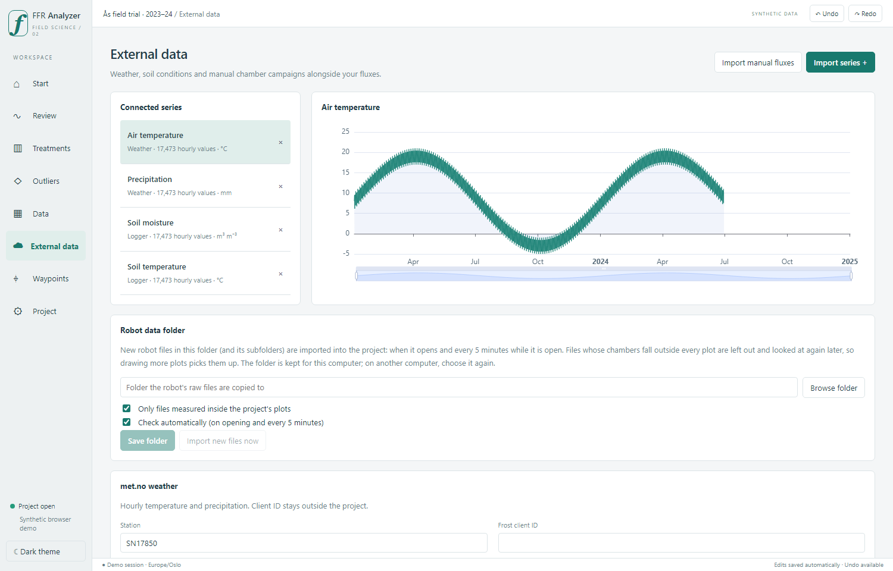
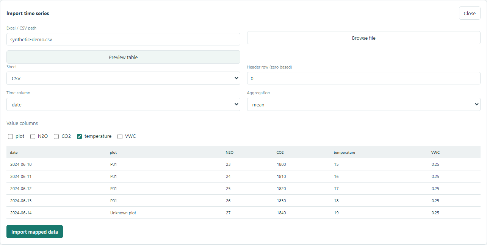

# External data

Open **External data** to bring weather, logger readings and manual chamber fluxes into your project. In **Connected series**, click a series to preview it. Drag the handles below the chart to inspect a shorter time period. Click **×** next to a series to delete it from the project.

*Select a connected series to preview it. The page also has controls for robot files and weather.*

## Import a logger or other time series

1. Click **Import series +**, then **Browse file**. Choose an Excel workbook or comma-separated CSV file. The workbook reader supports `.xls`, `.xlsx`, `.xlsm`, `.xlsb` and `.ods`.
2. Click **Preview table**. The first workbook preview looks for a sheet named `Measurements`. If the workbook has no such sheet, use a copy with that sheet name or save the sheet as CSV. For CSV, **Sheet** can be set to **CSV**.
3. Set the options below. After changing the sheet or header row, click **Preview table** again so the displayed column names match the file.
4. Click **Import mapped data**. Select each new series in **Connected series** and check the chart.

| Field | What to enter |
| --- | --- |
| **Sheet** | Worksheet containing the observations. |
| **Header row (zero based)** | The row with the column names. Use `0` for the first row, or `2` if you have two leading rows before the names. |
| **Time column** | Column containing the date and time. For a CSV, a format such as `2024-06-10 14:30:00` works for local project time. You can also include a time-zone offset, as in `2024-06-10T14:30:00+02:00`. |
| **Value columns** | Tick the numeric columns to import. Each becomes a separate series. |
| **Aggregation** | For each series and timestamp, **mean** averages the readings, **sum** adds them, and **none** keeps the first valid reading in file order. |

Rows with unreadable dates or missing numeric values for a series are skipped for that series.

*Check the preview before importing the mapped columns.*

## Match series to fluxes

In [Data](06-data-and-export.md), use **Columns** to show the imported weather or logger values. For each flux row, the app looks for the nearest reading in each series, before or after the measurement. If it falls within the series' maximum time gap, the value appears in the row and can be exported. Otherwise the cell is blank. New imports and Frost series use a maximum gap of one hour. The import screen uses that default automatically.

Use distinct column names when importing different series. If two series share the same name, the later series supplies the values for that column in **Data**.

## Fetch met.no weather

1. Open the Frost guide and choose **Create a User**. Register with your email address and copy the client ID. [How to use Frost](https://frost.met.no/howto.html)
2. In **External data**, find **met.no weather**. Paste the ID into **Frost client ID**. The app stores the ID in settings for your Windows user, outside the project file. Enter the ID again each time you fetch weather because the field clears after use.
3. Set **Station** to the Frost station ID for your site. The default is `SN17850`. Set **From** and **To** for the requested interval. The app sends both dates at midnight UTC, so use the following day as **To** to cover the whole final day.
4. Click **Fetch weather**. The resulting series can include air temperature, hourly minimum and maximum air temperature, and hourly precipitation. The app uses air temperature to calculate robot fluxes and displays daily temperature and precipitation in **Treatments**.

## Import manual chamber fluxes

Use **Import manual fluxes** for fluxes already calculated from a manual chamber campaign. Set **Sheet**, **Header row (zero based)** and **Time column** after previewing the table, as for a time series. Prepare the following columns.

| Column | Contents |
| --- | --- |
| Date or time column of your choice | Select its name in **Time column**. The app adds 12 hours to every imported timestamp, so a date at midnight is shifted by 12 hours. The offset is fixed in this wizard. |
| `plot` | Numeric **Plot ID** in the project. For an existing plot with measurements, use **Data** and show **Plot ID** beside **Plot** to check the mapping. |
| `N2O` | N₂O flux in µg N m⁻² h⁻¹. |
| `CO2` | CO₂ flux in µg C m⁻² h⁻¹. |

If **Import mapped data** is disabled, tick a gas under **Value columns**. The manual importer reads the named gas columns whenever they are present. Click **Import mapped data**. Check the new **manual** rows in **Data**, especially the times, plot assignments and flux values. In **Treatments**, tick **manual** to include them in the comparison.

## Watch a robot data folder

1. In **Robot data folder**, click **Browse folder** and choose the folder where robot files are copied. The scan checks that folder and up to three levels of subfolders.
2. Set **Only files measured inside the project's plots**. With this option ticked, a file qualifies if the project assigns at least one of its measured chambers to a plot. A project with no plots accepts files from any position. Untick it to import files regardless of position.
3. Tick **Check automatically (on opening and every 5 minutes)** to check when the project opens and every five minutes while it is open. Click **Save folder**. Saving with this option on also starts a check.
4. To check on demand, click **Import new files now**. Read **Last checked** below the buttons for the time, number of robot files found, number already in the project, number outside the plots, number imported and any read failures.

The scan recognises files by the robot's original date, time and position in the filename. It reads original robot pickle files and gzip-compressed JSON robot files (`.gz`). It skips files already imported successfully. Files outside the plots are checked again on the next scan, so a later plot change can bring them in. A file with a valid robot name that fails to load appears as a failed measurement. The scan tries it again and replaces the failed entry if the file becomes readable.

The saved folder path refers to this computer. If the path is unavailable on another computer, choose the local folder there. Use **Forget folder** to remove the folder setting and stop automatic checks.

To import an individual robot raw file, open **Project**, click **Add robot files...** and select the file. This uses the selected file directly, independent of the folder's plot filter. See [Project](08-project.md).
