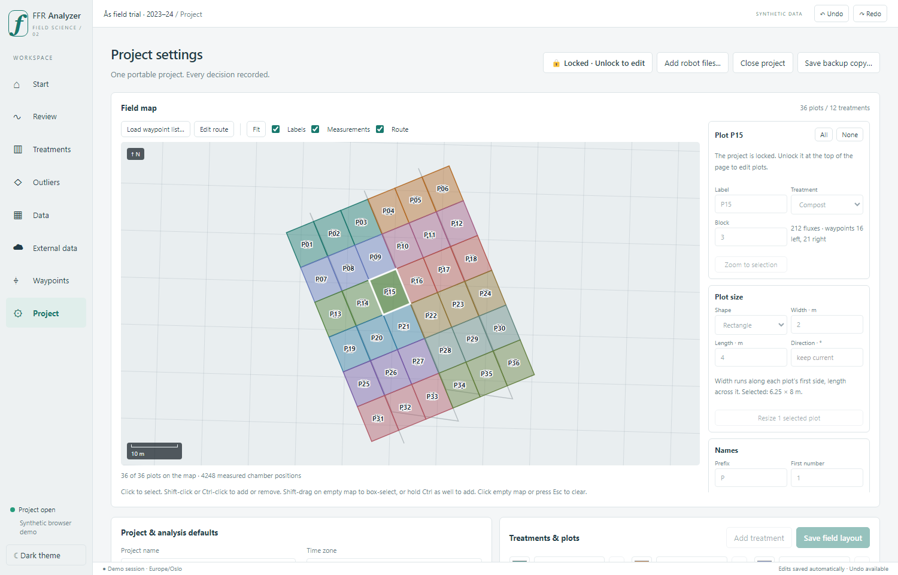

# Project settings and field layout

Open **Project** to set the analysis defaults, manage treatments and plots, or make a backup. The screen opens locked. You can inspect and select plots while it is locked. Choose **Unlock to edit** at the top of the page to make changes. Save or discard both the settings draft and the layout draft before choosing **Lock** again.

*The selected plot’s label, treatment and block appear beside the field map.*

## Set the project and analysis defaults

In **Project & analysis defaults**, check the time zone before analysing robot files. The date and time in each file name are local to the field site. The app uses the project time zone to turn that time into an absolute timestamp and align the valve log with the concentration traces. It also uses the zone to display times and group measurements into local days.

| Setting | Default for a new project | What it controls |
| --- | --- | --- |
| **Project name** | Name given when you create the project | The name shown in the app. |
| **Time zone** | `Europe/Oslo` | Use a region name such as `Europe/Oslo` so daylight saving rules are applied for the measurement date. |
| **start · s** | 0 s | Start of the regression window, measured from the start of the trace. |
| **stop · s** | 180 s | End of the regression window. The ending sample is left out of a fixed-window fit. |
| **cutBeginnings · s** | 4 s | Trim at the beginning of each chamber segment while the gas signal settles after a switch. |
| **cutEnds · s** | 3 s | Trim at the end of each chamber segment before the next switch. |
| **Fit method (N₂O, CO₂)** | **Least squares (legacy)** | Choose **Robust refit** to report the refit for these two gases when available. |
| **Fallback temperature · °C** | 20 °C | Temperature used to convert the slope to flux when the project has no usable air temperature series. |
| **Chamber height · m** | 0.5 m | Effective chamber height used in the flux conversion. |

New projects start in fixed-window mode. Use **Review** for individual changes to the window, mode, valve offset or per-gas settings. **Project** displays the configured gases and reporting units for reference. N₂O is reported as µg N m⁻² h⁻¹ and CO₂ as µg C m⁻² h⁻¹. CO and the two water-vapour channels, **H2O** and **licor_H2O**, use mol m⁻² s⁻¹.

Choose **Save & recompute** to save the settings and recalculate robot regressions, fluxes, plot assignments and diagnostics. A time-zone change also reinterprets the file-name times of stored robot measurements. Robot fluxes with their own analysis options keep those options when they are recalculated. Imported manual flux values are already calculated. Use **Discard changes** beside the settings to abandon this draft. See [How fluxes are calculated](10-how-fluxes-are-calculated.md).

## Diagnostic thresholds

Expand **Diagnostic thresholds** in **Project & analysis defaults**. The thresholds control which findings appear and how they are ranked. The robust refit settings also affect the reported N₂O and CO₂ flux when **Robust refit** is selected. Findings never exclude a flux automatically. A gas’s noise floor is based on the median flux standard error from included robot measurements. A robust SD measures scatter using the median absolute deviation, or MAD.

### Noise floor

| Field | Default | Meaning |
| --- | --- | --- |
| **Noise floor multiplier · ×** | 3 | Multiplies each gas’s median flux standard error to set its noise floor. |

### Shape

| Field | Default | Meaning |
| --- | --- | --- |
| **Extra robust trim · s** | 3 s | Trims this much time from each end of a chamber segment for the robust refit. |
| **Robust refit residual cutoff · robust SD** | 4 | Drops points whose residual differs from the median by more than this in the robust refit. |
| **Minimum shape effect · noise floors** | 1 | Requires the robust and original fluxes to differ by more than this before rating the shape effect. |
| **Shape warning impact · fraction** | 0.15 | Sets the minimum effective impact for a shape warning. |
| **Shape bad impact · fraction** | 0.35 | Sets the minimum effective impact for a shape finding rated bad. |
| **Edge-to-interior residual ratio · ×** | 2.5 | Flags segment edges when their mean absolute residual exceeds this multiple of the interior mean. |
| **Spike residual cutoff · robust SD** | 6 | Flags a spike when a fitted point’s residual differs from the median by more than this. |
| **High residual noise ratio · ×** | 4 | Flags high noise when residual SD exceeds this multiple of the gas’s baseline residual SD. |
| **Curvature p-value cutoff · probability** | `1e-12` | Requires the quadratic F-test p-value to fall below this cutoff. |
| **Curvature slope difference · fraction** | 0.4 | Requires slopes from the two halves of the fit to differ by more than this fraction of the larger absolute slope. |
| **Gases checked for curvature** | N₂O, CO₂ | Select which gas traces are checked for curvature. |

### Valve timing

| Field | Default | Meaning |
| --- | --- | --- |
| **Valve lag search radius · s** | 10 s | Searches this far before and after the current valve timing. |
| **Valve lag search step · s** | 0.5 s | Sets the time between candidate lags. |
| **Valve lag search trim · s** | 0.25 s | Trims this much time from each end of a segment during the lag search. |
| **Minimum chamber contrast · robust SD** | 4 | Requires the two chambers’ concentrations to differ by more than this many robust noise SDs. |
| **Minimum valve lag improvement · fraction** | 0.30 | Requires this fractional reduction in squared residuals to use the estimated lag. |
| **Minimum valve lag · s** | 1 s | Minimum difference between the estimated lag and the current shift that raises a valve timing finding and lets the robust refit use the estimate. |

### Chamber leak

| Field | Default | Meaning |
| --- | --- | --- |
| **Minimum daily leak observations · count** | 6 | Requires this many included robot observations for the daily CO₂ comparison. |
| **Minimum leak reference · noise floors** | 5 | Requires the reference flux for a leak comparison to exceed this many noise floors. |
| **Low flux leak cutoff · fraction** | 0.25 | Flags a possible leak when the flux is below this fraction of its reference. |
| **Other-chamber CO₂ leak cutoff · fraction** | 0.5 | Rates a daily CO₂ leak finding bad if the other chamber exceeds this fraction of the day’s CO₂ median. |

### Negative flux

| Field | Default | Meaning |
| --- | --- | --- |
| **Negative flux p-value cutoff · probability** | 0.01 | Requires the slope p-value to be below this cutoff for falling N₂O or CO₂. |
| **Falling CO₂ bad cutoff · noise floors** | 1 | Rates significantly negative CO₂ bad when its magnitude exceeds this many noise floors. |
| **Falling N₂O info cutoff · noise floors** | 1 | Flags significantly negative N₂O when its magnitude exceeds this many noise floors. |
| **Falling N₂O warning cutoff · noise floors** | 3 | Raises a falling N₂O finding to warning when its magnitude exceeds this many noise floors. |
| **Falling N₂O bad cutoff · noise floors** | 5 | Rates falling N₂O bad when its magnitude exceeds this many noise floors. |

### Neighbours

| Field | Default | Meaning |
| --- | --- | --- |
| **Same-treatment search radius · days** | 3 days | Looks this many days either side of the measurement for neighbours in the same treatment. |
| **Same-plot search radius · days** | 10 days | Looks this many days either side for same-plot neighbours when the treatment has too few. |
| **Minimum neighbours · count** | 6 | Requires this many neighbours to score a flux. |
| **Minimum transformed neighbour spread · asinh scale** | 0.15 | Sets a lower bound on the robust spread used to score fluxes after the asinh transform. |
| **Transformed outlier cutoff · z-score** | 3.5 | Requires the outlier score on the asinh scale to exceed this cutoff. |
| **Raw outlier cutoff · z-score** | 8 | Requires the outlier score on the original flux scale to also exceed this cutoff. |
| **Transformed bad outlier cutoff · z-score** | 10 | Rates an outlier bad if its score on the asinh scale exceeds this cutoff. |
| **High-flux outlier ratio · ×** | 10 | Rates a high outlier bad above this multiple of the neighbours’ median absolute flux if it also clears the noise-floor cutoff. |
| **High-flux outlier cutoff · noise floors** | 5 | Requires a high outlier to clear this many noise floors to be rated bad by the ratio rule. |

### Valves and points

| Field | Default | Meaning |
| --- | --- | --- |
| **Expected valve switch count · count** | 10 | Flags the valve sequence when the switch count differs from this value. |
| **Expected chamber segment duration · s** | 20 s | Sets the reference duration used to check full chamber segments. |
| **Segment duration tolerance · fraction** | 0.5 | Flags a chamber segment when its duration differs from the expected duration by more than this fraction. |
| **Minimum fitted points · count** | 20 | Flags a fit that uses fewer points than this. |
| **Minimum fit span · s** | 60 s | Flags a fit when its time span is shorter than this. |

### Dropouts

| Field | Default | Meaning |
| --- | --- | --- |
| **Maximum gap between readings · s** | 5 s | Flags N₂O or CO₂ when readings within a chamber segment and fit window are further apart than this. |

See [Diagnostics](03-diagnostics.md) for how to inspect a finding in **Review**.

## Inspect the field map and plot assignments

The map draws plot boundaries in their treatment colours. Use **Labels**, **Measurements** and **Route** to show or hide the respective layers. The measurement dots show chamber positions. Red dots mark positions with an unassigned flux. A plot without a boundary, such as a plot imported with waypoint mappings alone, can still have assigned fluxes.

| Assignment | How it works |
| --- | --- |
| Polygon | The app checks whether the chamber position is inside a plot boundary. |
| Waypoint table | A plot can store pairs of waypoint number and chamber side. Route-generated plots and some legacy imports supply these pairs. |
| Per-flux override | In **Review**, open **Plot assignment & note** and choose the plot for that flux. |

A manual override takes precedence. Automatic assignment uses the first plot in layout order with a matching waypoint number and chamber side. If no visit matches, it uses the first plot whose polygon contains the chamber position.

| Key or mouse action | Result |
| --- | --- |
| Wheel | Zoom around the pointer. |
| Drag empty map, or drag with the right or middle button | Pan. |
| **Fit** or `F` with the map focused | Fit the field to the map. |
| Click a plot | Select that plot. |
| `Shift`-click or `Ctrl`-click | Add or remove a plot. |
| `Shift`-drag from empty map | Select plots with centres inside the box. Hold `Ctrl` as well to add them to the current selection. |
| Click empty map, press `Esc` with the map focused, or choose **None** | Clear the selection. |
| **All** or `Ctrl+A` with the map focused | Select all plots. |
| Drag a plot when unlocked | Move it. Drag a plot in a selection to move the whole selection. |
| `Ctrl+Z` or `Ctrl+Y` outside a form field | Undo or redo layout edits within the draft. |

## Edit treatments and plots

1. Unlock the project. In **Treatments & plots**, choose **Add treatment**. Edit the name in its text field and click the colour swatch to choose a colour. To remove a treatment, first move its plots to another treatment, then click **×** beside its name.
2. Select one plot on the map to change its **Label**. Select one or more to set **Treatment** or **Block** together. With editing unlocked, **Zoom to selection** fits the selected boundaries in the map. For plots without boundaries, use **Edit plot labels and treatment assignments** in **Treatments & plots**.
3. To change footprints, use **Plot size** and choose a shape from the table below. Then choose **Resize**. With an empty selection this applies to all plots with boundaries.
4. To renumber plots, set **Prefix** and **First number** under **Names**. Set **Fill** to **Rows**, **Columns** or **Current order**. For rows or columns, choose the starting corner as seen on the north-up map. Turn on **Snake** to reverse the direction on every other row or column. Choose **Rename** to apply to the selection, or to all plots if the selection is empty.
5. Choose **Save** above the map or **Save field layout** in **Treatments & plots**. This saves the entire layout draft, rechecks robot flux assignments and creates one project undo step. Use **Discard** above the map to abandon the draft.

| **Shape** | How to size it |
| --- | --- |
| **Rectangle** | Set **Width · m** along the plot’s first side and **Length · m** across it. |
| **Square** | Set **Side · m**. |
| **Auto square (touching)** | Size each square from the distance to the nearest other plot centre. The side equals that distance. A lone plot gets a 2 m side. |
| **Maximize** | Keep the width and set the length along travel to fit up to a neighbour. With no neighbour to set the length, the footprint stays as it is. Leave **Travel direction · °** blank to use the stored route, with the layout’s length direction as a fallback. |

Resizing keeps each plot centred. For the rectangle and square modes, leave **Direction · °** blank to keep the existing orientation, or enter an angle in degrees from grid east towards grid north.

## Open a route or add offline imagery

Choose **Load waypoint list…** to open a route CSV in **Waypoints**. Choose **Edit route** when a route is already stored in the project. Both open the route editor, where you can preview plots before applying them. See [Waypoints](09-waypoints.md).

To add a background to the field map, open **Waypoints**, then **Map setup** → **Imagery folder…**. Choose the root of a local Web Mercator XYZ tile folder with files such as `{z}/{x}/{y}.jpg` or `{z}/{x}/{y}.png`. Both maps use this app-wide preference. Choose **No imagery** to clear it. The maps can use a coarser local tile where available, and work offline.

The project map interprets positions and boundaries as WGS 84 / UTM in metres. The default is `EPSG:32632` (zone 32 north). Northern zones use `EPSG:32601` to `EPSG:32660`, and southern zones use `EPSG:32701` to `EPSG:32760`. The desktop project screen has no coordinate-system field. **Map setup** shows the project’s coordinate system while a project is open and lets you set the map coordinate system for route viewing without a project.

## Save a backup copy

Save any drafts you want included, then choose **Save backup copy…** and give the copy a new `.ffr` file name. The app makes a consistent copy of the saved project while you keep the original open.
