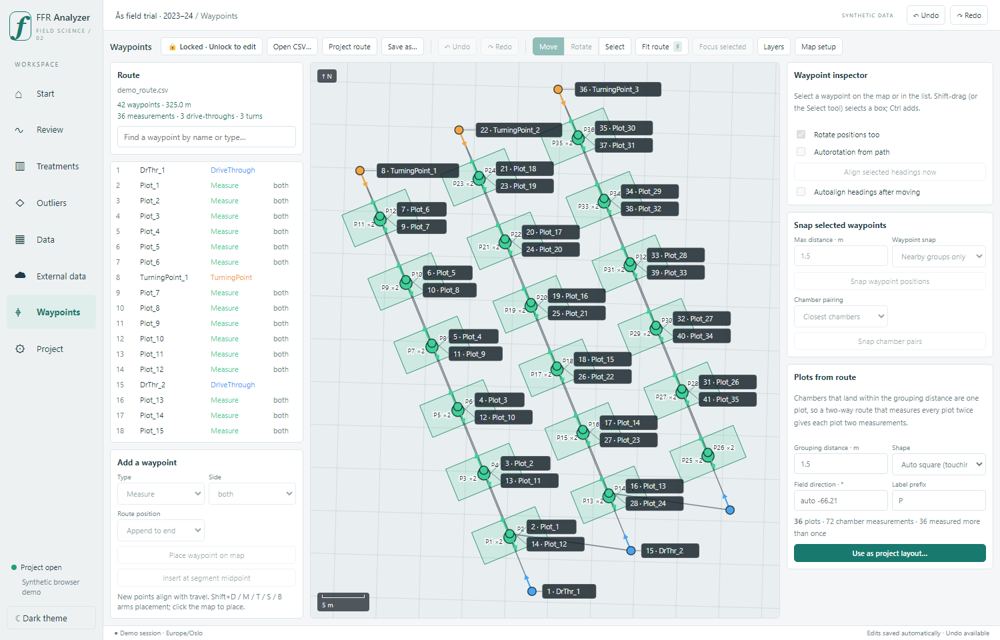

# Waypoints and robot routes

Open **Waypoints** to inspect or edit a robot route and turn its chamber positions into a field layout. You can use the editor with or without an open project.

*The map previews the route and plot footprints. The panel counts chamber visits and plots measured more than once.*

## Open a route CSV

Choose **Open CSV…** and select a route file. If the project has a stored route, **Project route** loads that copy. From **Project**, **Load waypoint list…** opens a CSV in this editor and **Edit route** opens the stored route. From **Start**, **New project from waypoint list…** opens a route for making a new project.

Use a comma-separated UTF-8 file with seven columns and no header. Each row gives one waypoint in travel order. For example, `599233.53,6615294.31,0,1.570796,Measure,both,Plot_15` describes a waypoint facing grid north that measures with both chambers.

| Column | What to put in it |
| --- | --- |
| `X`, `Y`, `Z` | Easting, northing and height in metres. Use a decimal point. |
| `Angle` | Heading in radians. Zero is grid east. Positive angles turn anticlockwise towards grid north. The inspector displays degrees. |
| `Type` | `Measure`, `DriveThrough`, `TurningPoint` or `Stop`. Only `Measure` creates chamber visits for plot generation. |
| `MeasureSide` | `both`, `left`, `right` or `none`. Use `none` when no chamber measures at the waypoint. |
| `Name` | A non-empty name. The app uses the last run of digits as the waypoint number. For example, `Plot_15` gives `15`. |

## Inspect and navigate the map

The route opens locked. You can pan and zoom, select points and inspect their fields without changing the route. Under **Route**, search by name or type to narrow the list. Under **Layers**, toggle **Names**, **Route line**, **Headings**, **Chambers** or **Plots from route**. Use **Focus selected** to zoom to the selection.

Open **Map setup** to check the **Coordinate system**. The map uses the open project’s coordinate system. With no project open, you can enter the UTM zone of the route, for example `EPSG:32632` for zone 32 north. This changes where the map draws the numbers in the CSV. The coordinates in the file stay the same. **Imagery folder…** and **No imagery** set or clear the offline background shared with the [Project field map](08-project.md#open-a-route-or-add-offline-imagery).

## Edit the route

Choose **Unlock to edit**. You can start with an empty map and place points, or change an existing route.

### Move, rotate or edit fields

- Choose **Move** and drag a waypoint. To move several together, select them first and drag one of the selected waypoints.
- Select a waypoint and drag its rotation handle, or choose **Rotate** and drag to change its heading. With several points selected, the group rotates around its centre. Clear **Rotate positions too** to rotate their headings in place.
- For one selected point, use **Waypoint inspector** to edit **Type**, **Measure side**, **X / easting · m**, **Y / northing · m**, **Z · m** or **Heading · °**. Numeric edits apply on `Enter` or when you leave the field. **Name** is read-only. Changing **Type** can update the generated names.
- For several selected points, use **ΔX · m**, **ΔY · m** and **Rotate · °**, then choose **Transform selection**. This rotates the selection before moving it by the stated offsets.

### Add, insert or delete waypoints

1. In **Add a waypoint**, set **Type** and **Side**. **DriveThrough + TurningPoint** places two consecutive points at the same position.
2. In **Route position**, choose **Append to end**, **Insert before selected** or **Insert after selected**. Select an anchor waypoint for either insertion option.
3. Choose **Place waypoint on map**, then click the location. For insertion, you can instead choose **Insert at segment midpoint** to place the point halfway between the anchor and its neighbour on that side. New points are aligned with travel.

Select one or more waypoints and choose **Delete** to remove them. Inserting, deleting or changing type can renumber later waypoints of the affected type. Check names before using an edited route to assign older fluxes, since assignment uses waypoint numbers.

### Snap positions and align headings

Select at least two points before snapping. Use **Chambers** under **Layers** to see where the chambers will land.

| Setting or action | What it does |
| --- | --- |
| **Max distance · m** | Sets how far apart waypoints or chamber positions can be to qualify for snapping. The default is 1.5 m. |
| **Waypoint snap** → **Nearby groups only** | Groups selected waypoints whose positions are all within the distance of one another. **Snap waypoint positions** moves each group to its average position. |
| **Waypoint snap** → **All selected to one average** | **Snap waypoint positions** moves all selected waypoints to one average position regardless of their distance. |
| **Chamber pairing** | **Closest chambers** allows any measured-side pairing. **Left only** and **Right only** use the named side. **Left to right** pairs opposite sides, useful when the robot returns in the opposite direction. |
| **Snap chamber pairs** | Starts with the closest eligible chamber pair within **Max distance · m**. It adjusts waypoint positions and headings to line up the chambers. Each waypoint can be paired once. If both waypoints measure on both sides, it aligns both pairs of chambers. |
| **Align selected headings now** | Aligns the selected headings to the route once. It uses the incoming direction for **DriveThrough** and usually the outgoing direction for **Measure** and **TurningPoint**. Existing **Stop** headings are left in place. |
| **Autorotation from path** | Aligns the selection when switched on and keeps headings aligned during edits such as moving and changing coordinates. |
| **Autoalign headings after moving** | Aligns the moved waypoints when you finish dragging them. |

### Keyboard and mouse controls

| Key or mouse action | Result |
| --- | --- |
| Wheel | Zoom around the pointer. |
| Drag empty map with **Move** or **Rotate**, or drag with the right or middle button | Pan. |
| Click a waypoint or a list row | Select it. Double-click a list row to centre the map on it. |
| `Ctrl`-click | Toggle a waypoint in the selection. |
| `Shift`-click | Select a range in route order from the selection anchor. |
| `Shift`-drag from empty map, or drag from empty map with **Select** | Select waypoints in a box. Hold `Ctrl` as well to add to the selection. |
| `Ctrl+A` | Select all waypoints. |
| **Fit route** or `F` | Fit the whole route. |
| `Shift+D`, `Shift+M`, `Shift+T`, `Shift+S` or `Shift+B` | Prepare to place a **DriveThrough**, **Measure**, **TurningPoint**, **Stop** or **DriveThrough + TurningPoint**, respectively. Then click the map. |
| `Esc` | Cancel placement or the current editing gesture. |
| `Delete` | Delete the selected waypoints while unlocked. |
| `Ctrl+Z`, `Ctrl+Y` | Undo and redo route edits while unlocked. `Ctrl+Shift+Z` also redoes an edit. |
| `Ctrl+S` | Open **Save as…**. |

### Save the edited route

Choose **Save as…** and give the route a new CSV name. The suggested name ends in `_edited.csv`. The editor protects the source CSV from being overwritten. Save or undo changes before locking the editor again. If you open a different route with changes pending, the editor asks whether to discard them.

## Make plots from a route

The **Plots from route** preview shows what the robot measures. Each **Measure** row supplies one visit per measured side. By default, each chamber lies 2 m to the indicated side of the robot and 0.2 m forward along its heading. The app goes through these chamber positions in route order. It puts a chamber in the first group where it is within **Grouping distance · m** of every member. Otherwise, it starts a new group. This is called complete-link grouping. The average chamber position in each group becomes the plot centre. Two passes over the same plot can therefore give one footprint with two visits.

| Setting | Default | What to check |
| --- | --- | --- |
| **Grouping distance · m** | 1.5 m | Increase it to group passes that land farther apart. Decrease it if visits to distinct plots are grouped together. |
| **Shape** | **Auto square (touching)** | The side length equals the distance to the nearest other plot centre. A lone plot has a 2 m side. Choose **Fixed square** or **Fixed rectangle** for measured plot dimensions. |
| **Side · m** | 3 m | Side length for **Fixed square**. |
| **Width · m (along field)**, **Length · m (across)** | 2 m, 4 m | Dimensions for **Fixed rectangle**. |
| **Field direction · °** | Automatic | The app uses an edge of the smallest-area rectangle enclosing the plot centres. Enter an angle from grid east to use your own direction. Clear the field to return to automatic. |
| **Label prefix** | `P` | Labels start at 1 and follow the order in which the groups were created, for example `P1`, `P2`. |

Compare the plot count with the trial layout and check the number of chamber measurements and plots measured more than once. The map labels show the number of visits for plots with repeated measurements. A waypoint name without a number can still help form a plot, but its flux can only match the plot by position.

The app stores each plot’s waypoint-number and side pairs alongside its footprint. It checks all plots for a matching visit before looking for a polygon that contains the chamber position. Within each pass, the first match in layout order wins. The saved pairs keep fluxes assigned to their route plot when footprints move, resize or overlap. A per-flux manual override takes precedence.

- With no open project, choose **Create project from route…** and save a new `.ffr` file. The app stores the route and layout in the new project.
- With an open project, choose **Use as project layout…**, review the plot count and choose **Replace layout**. The app keeps the treatments, places the new plots in **Unassigned**, and rechecks robot flux assignments. Project **Undo** can restore the previous plot layout.

Saving the layout stores the route in the project. Use **Save as…** separately if you need the edited route as a CSV for the robot.
