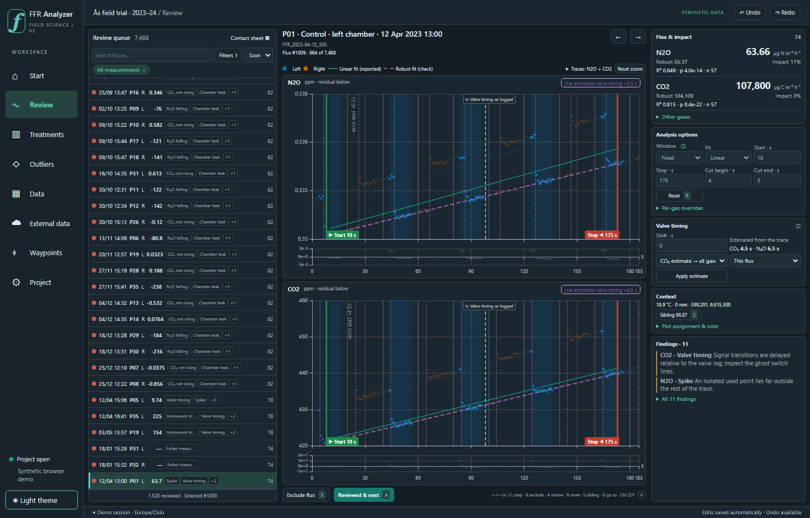

# FFR Analyzer user manual

FFR Analyzer turns the raw files from the Field Flux Robot into reviewed, exportable gas
fluxes. This manual follows the work in the order you usually do it: set up a project, review
the fluxes, look for problems, compare treatments, then export.

*The Review screen: the review queue on the left, the N2O and CO2 traces in the middle, and the
flux, findings and analysis options on the right.*

## Chapters

| Chapter | What you will learn |
|---|---|
| [1. Getting started](01-getting-started.md) | Install the program, create or open a project, convert a legacy project, find your way around the window. |
| [2. Reviewing fluxes](02-review.md) | Step through fluxes, adjust the regression window, exclude and mark reviewed, use the contact sheet, keyboard shortcuts. |
| [3. Why a flux needs attention](03-diagnostics.md) | What each finding means, how the attention score is set, what to do about it. |
| [4. Comparing treatments](04-treatments.md) | Cumulative emissions per treatment and plot, daily-mean distributions, individual fluxes and weather. |
| [5. Hunting outliers](05-outliers.md) | Linked scatter plots, selecting groups of fluxes, bulk actions. |
| [6. Data table and export](06-data-and-export.md) | Filter and sort every flux, save filter presets, export to Excel or CSV. |
| [7. External data](07-external-data.md) | Loggers and other time series, met.no weather, manual flux measurements, the robot data folder. |
| [8. Project settings and field map](08-project.md) | Time zone, default analysis options, diagnostic thresholds, treatments, plots and the field map. |
| [9. Waypoints and routes](09-waypoints.md) | Edit robot routes and create plots from a route. |
| [10. How fluxes are calculated](10-how-fluxes-are-calculated.md) | The methods, constants and formulas, for describing your analysis in a paper. |

## Quick start

1. Install the program from the [Releases page](../../../../releases) (see
   [Getting started](01-getting-started.md#install-on-windows)).
2. On **Start**, choose **New project…**, or **Import legacy project →** if you used the
   old Python program.
3. Under **External data → Robot data folder**, point the project at the folder the robot's
   files are copied to and choose **Import new files now**.
4. Draw or generate your plots under **Project** or **Waypoints**, and give them treatments.
5. Open **Review**. The queue starts with the fluxes that most need your attention. Use
   `A` to mark a flux reviewed and move on, `X` to exclude it.
6. Compare treatments under **Treatments**, and export from **Data**.

Every change is saved to the project file immediately and can be undone with Ctrl+Z.

## Trying it without data

Developers can run the interface in a web browser on synthetic data (see
[app/README.md](../../app/README.md)). All pictures in this manual come from that synthetic
demo project, so the numbers in them are made up.

## Other documentation

- [Command-line tool (ffr-cli)](../CLI.md), for developers and batch checks.
- [Specification](../SPEC.md), the technical contract the program is built to.
- [Desktop app developer guide](../../app/README.md).
